# Taskify Architecture

Companion documents: [features.md](features.md) (what and why) and [milestones.md](milestones.md) (delivery order). Source material: [initial.md](initial.md) and [agentic.md](agentic.md).

Diagrams are written in Mermaid. They render on GitHub and in VS Code with a Mermaid preview extension.

Contents:

1. [Scope and current state](#1-scope-and-current-state)
2. [High-level design](#2-high-level-design)
3. [Flows](#3-flows)
4. [Data model](#4-data-model)
5. [Low-level design](#5-low-level-design)
6. [Cross-cutting concerns](#6-cross-cutting-concerns)
7. [Where this document departs from the source documents](#7-where-this-document-departs-from-the-source-documents)
8. [Decisions](#8-decisions)
9. [Clients and portability: contract, Python, CLI, web frontend](#9-clients-and-portability)

Sections 2 to 6 describe the Go service. Section 9 describes what is built around it; it is placed last so that existing section numbers stay stable.

---

## 1. Scope and current state

**Target:** a multi-tenant Go task service that emits task lifecycle events to AgentPulse through a transactional outbox, and runs background LLM agents that enrich, decompose, and unblock tasks under human-in-the-loop controls. Around it sit a language-neutral contract, a CLI, a web frontend, and a Python client SDK (section 9). There is one server, in Go.

**Today:** `main.go` prints a greeting and reads `PORT`. `internal/router/routes.go` references undefined handlers and does not compile. `go.mod` declares module `taskify` with `chi` and `godotenv`. There is no persistence. Everything below is to be built.

**Not verified:** the AgentPulse repository is not in this workspace. The AgentPulse field names and endpoints in this document come from [initial.md](initial.md) and from the project owner's answers recorded in section 8.1. None has been read from AgentPulse code, so milestone M0 checks them against the real contract.

---

## 2. High-level design

### 2.1 System context

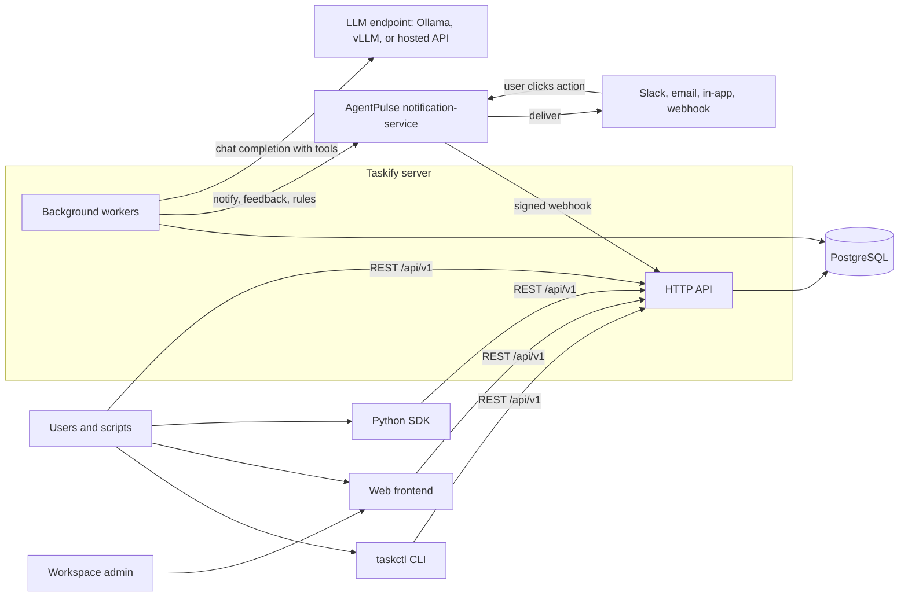

Taskify owns task data and decides **what happened**. AgentPulse decides **who is told, when, and how**. The LLM proposes actions; Taskify's Go code decides whether and how they run.

### 2.2 Containers and components

One Go binary runs the API and all workers. Workers coordinate through PostgreSQL row locks, so any number of replicas can run.

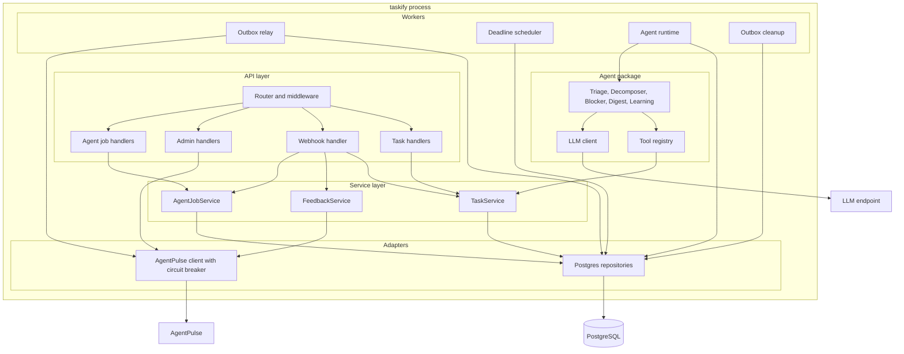

### 2.3 Component responsibilities

| Component | Responsibility | Never does |
| --- | --- | --- |
| API layer | Parse, authenticate, validate, map errors to HTTP status | Call AgentPulse or the LLM for task writes |
| `TaskService` | Apply business rules, run the transaction that writes task, outbox, and agent job rows | Network I/O |
| `FeedbackService` | Forward feedback signals to AgentPulse | Mutate tasks |
| `AgentJobService` | Apply or dismiss Tier 2 proposals | Call the LLM |
| Outbox relay | Claim pending outbox rows, call AgentPulse, record result | Create events |
| Deadline scheduler | Find due-soon, overdue, and stale tasks; write events and jobs | Call AgentPulse directly |
| Agent runtime | Claim agent jobs, run the reasoning loop, record history | Mutate tasks except through tools |
| Tool registry | Validate and execute typed tool calls via `TaskService` | Accept tenant or scope from model output |
| LLM client | OpenAI-compatible chat completion with tool calling, timeout, retry | Hold business logic |
| AgentPulse client | Typed calls, circuit breaker, trace header injection | Retry on its own (the relay owns retry) |
| Repositories | SQL, transactions, optimistic locking, `SKIP LOCKED` claims | Business rules |

### 2.4 Design principles

1. **No remote calls on the write path.** HTTP handlers write to PostgreSQL only. This keeps API latency independent of AgentPulse and LLM latency.
2. **One transaction per state change.** Task row, outbox rows, and agent job rows commit together or not at all.
3. **At-least-once delivery, deduplicated downstream.** The relay may send an event twice; the deterministic idempotency key makes that harmless.
4. **PostgreSQL is the only coordinator.** `FOR UPDATE SKIP LOCKED` replaces a distributed lock manager or message broker.
5. **Models propose, Go disposes.** The LLM emits tool calls. Typed Go code validates, tiers, and executes them.
6. **Humans approve what is hard to undo.**

---

## 3. Flows

### 3.1 Task write with transactional outbox

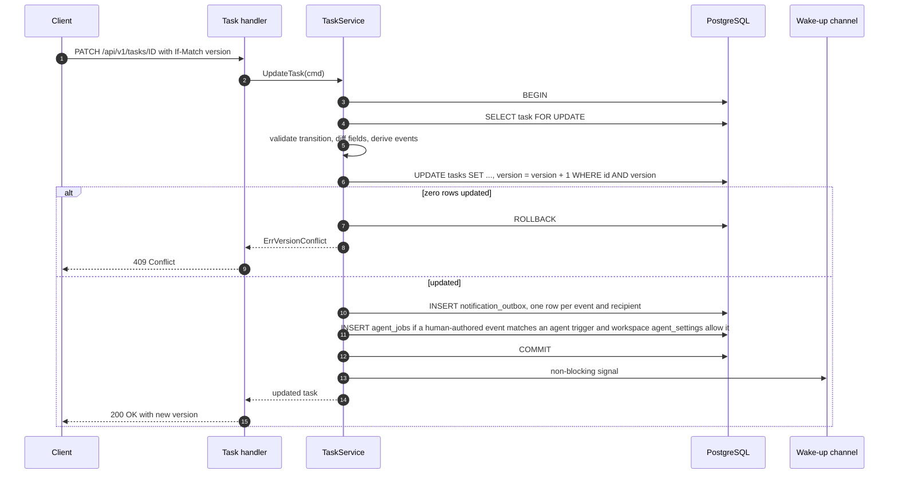

### 3.2 Outbox relay dispatch

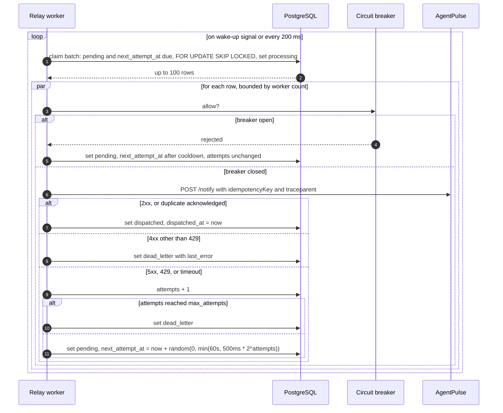

A reaper returns rows left in `processing` for longer than a lease period (for example 60 seconds) to `pending`. This covers a relay that crashes between claim and result.

### 3.3 Deadline scheduler

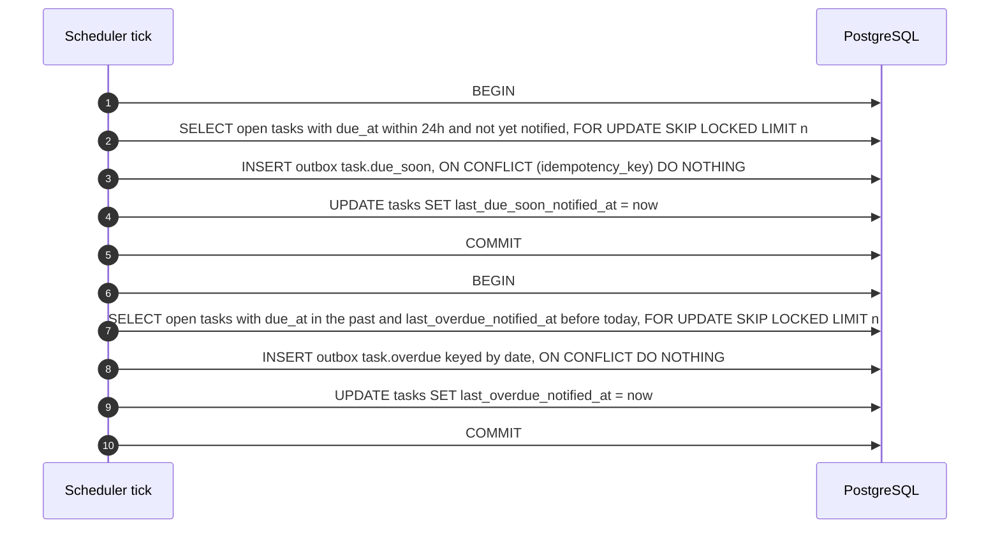

Two protections make this safe across replicas: `SKIP LOCKED` prevents two schedulers from taking the same task, and the unique `idempotency_key` prevents a second insert if they somehow do. The same tick enqueues `blocker_investigator` jobs for tasks `in_progress` with no comment in 48 hours.

### 3.4 Notification pipeline inside AgentPulse

Shown for orientation. Taskify does not implement this.

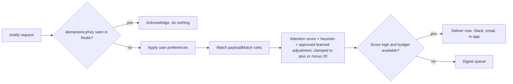

### 3.5 Feedback and inbound action webhook

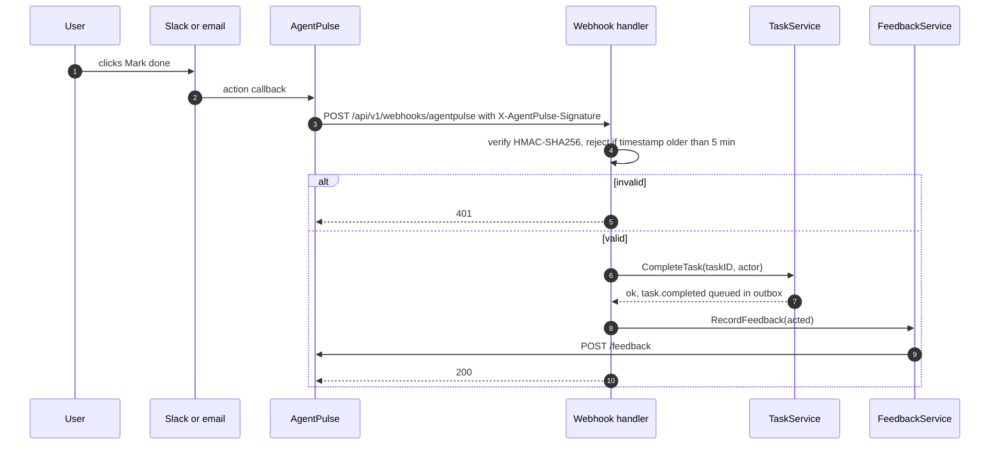

The direct path, `POST /api/v1/tasks/{id}/feedback`, skips the webhook and calls `FeedbackService` for signals raised inside a Taskify client.

### 3.6 Agent job loop

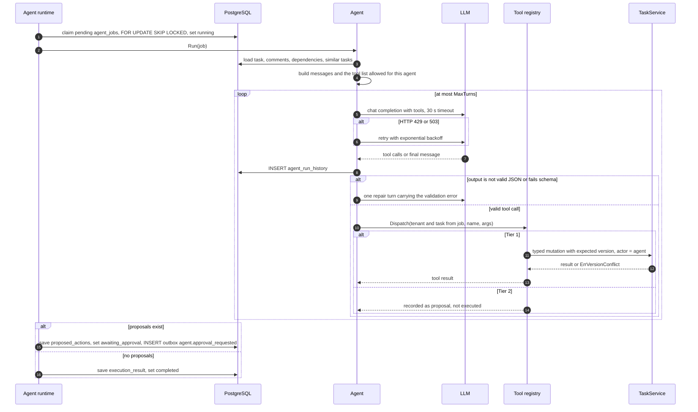

On `ErrVersionConflict` the job is returned to `pending` so the next run sees the human's edit. On an unrecoverable error the job is set to `failed` with `error_message`. A failed job never leaves partial Tier 1 writes from the same tool call, because each tool call is one transaction.

### 3.7 Human-in-the-loop approval

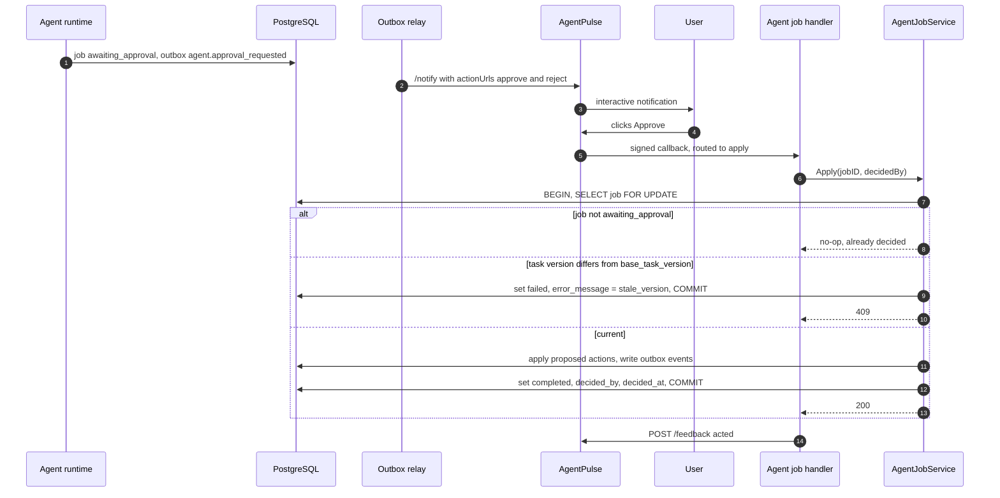

Reject follows the same path to `dismissed`, changes no task data, and records `dismissed` feedback.

### 3.8 Task decomposition

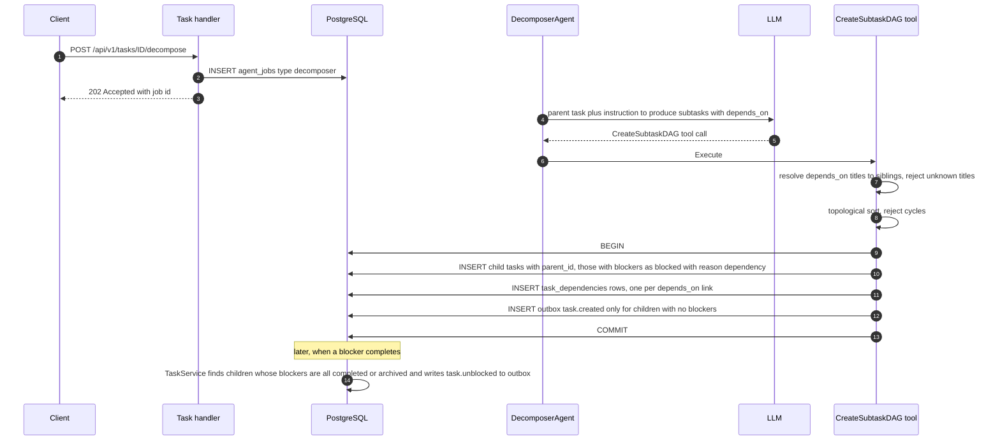

---

## 4. Data model

### 4.1 Entity relationship diagram

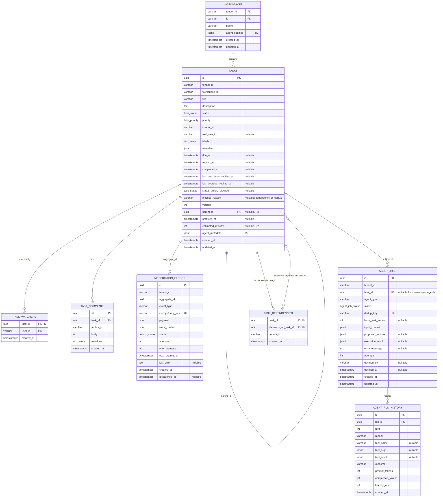

### 4.2 Table notes

| Table | Migration | Notes |
| --- | --- | --- |
| `tasks` | `000001`, extended by `000003` | Full DDL for the base columns is in [initial.md](initial.md) section 4.B. IDs are UUIDv7 generated in Go so they sort by creation time. |
| `task_watchers` | `000001` | Composite primary key `(task_id, user_id)`. |
| `task_comments` | `000001` | `mentions` is extracted from `@username` tokens at insert time. |
| `notification_outbox` | `000002` | One row per event per recipient. `idempotency_key` is unique. `aggregate_id` has no foreign key so outbox rows survive task deletion. |
| `task_dependencies` | `000003` | Replaces the `blocked_by UUID[]` column (decision 4). One row means `task_id` cannot start until `depends_on_task_id` is complete. Both foreign keys cascade on delete, which only fires on a permanent delete. A `CHECK (task_id <> depends_on_task_id)` blocks self-dependency. The foreign keys do not prove both tasks share a tenant, so the service checks that before insert. |
| `workspaces` | `000001`; `agent_settings` added in `000003` | Primary key `(tenant_id, id)`, with `name`. `tasks (tenant_id, workspace_id)` has a foreign key to it (decision 19). The table is created in `000001`, not `000003`, so the foreign key exists from the first task: adding it later would need a backfill of every workspace ID already used, and task creation would start failing for unknown workspaces. `agent_settings` defaults to agents off, approval required for everything, and a cap of 5 subtasks. The foreign key is `ON DELETE RESTRICT` (decision 24): a workspace cannot be deleted while any task references it, so an accidental delete cannot bypass soft archive, outbox scrubbing, or agent job cleanup. There is deliberately no workspace purge endpoint. If a workspace ever has to be decommissioned, it is done with an administrative script that verifies soft archives, drains the outbox, and cleans dependencies before touching the workspace row. |
| `agent_jobs` | `000003` | Base DDL in [agentic.md](agentic.md) section 4.A, with the changes listed in section 7 below. |
| `notification_acks` | `000004` (R3) | `(tenant_id, user_id, notification_id)` primary key, `signal`, `acked_at`. Local read state for the in-app feed (section 9.6). Not shown in the diagram above; it references AgentPulse notification IDs, not Taskify rows. |
| `agent_run_history` | `000003` | One row per model turn. Named in the AG-102 backlog item but not defined in the source; this definition is proposed here. |

Indexes:

| Index | Purpose |
| --- | --- |
| `idx_tasks_tenant_assignee_status (tenant_id, assignee_id, status)` | List and workload queries |
| `idx_tasks_due_scan (due_at, status)` partial on open tasks with a due date | Deadline scheduler |
| `task_dependencies` primary key `(task_id, depends_on_task_id)` | "What is this task waiting on?" |
| `idx_task_deps_reverse (tenant_id, depends_on_task_id)` | "Which tasks are waiting on this one?" |
| `idx_tasks_parent (parent_id)` partial where not null | Listing subtasks |
| `idx_outbox_poll (next_attempt_at, created_at)` partial where `status = 'pending'` | Relay claim |
| `idx_agent_jobs_poll (status, created_at)` partial where `status = 'pending'` | Agent runtime claim |

### 4.3 State machines

**Task status.** Transitions as decided (decision 9).

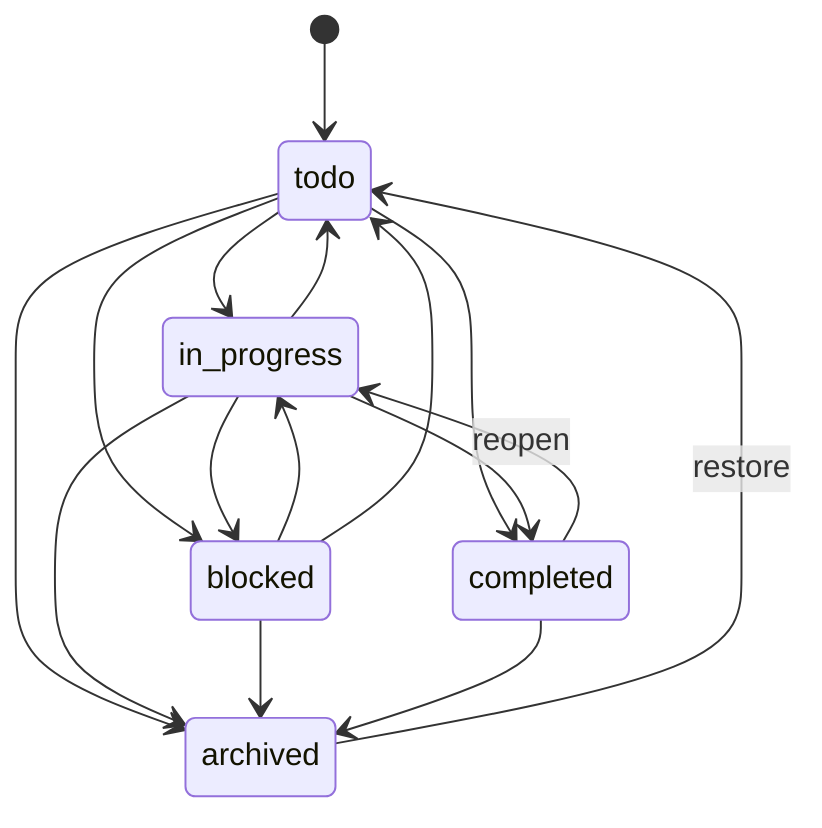

| Current | Allowed targets |
| --- | --- |
| `todo` | `in_progress`, `completed`, `blocked`, `archived` |
| `in_progress` | `blocked`, `completed`, `todo`, `archived` |
| `blocked` | `in_progress`, `todo`, `archived` |
| `completed` | `in_progress` (reopen), `archived` |
| `archived` | `todo` (restore) |

Anything else fails with `ErrInvalidStateTransition` before any database or outbox write.

- Entering `blocked` emits `task.blocked`.
- Entering `completed` sets `completed_at` and emits `task.completed`. Reopening clears `completed_at`.
- Entering `archived` sets `archived_at`. Restoring clears it.
- List and scan queries exclude `archived`. A fetch by ID still returns an archived task, so it can be restored.

- `todo` → `completed` is allowed directly (decision 18), so "Mark done" works on a task that was never started. It emits one `task.completed` event and no synthetic `in_progress` step, which keeps cycle-time metrics honest.
- A `blocked` task cannot be completed directly; it must return to `in_progress` or `todo` first.
- Entering `blocked` records the status the task came from in `status_before_blocked` and why in `blocked_reason`. Both are cleared on leaving `blocked`. A check constraint keeps them in step with the status: `blocked_reason` is set exactly when `status = 'blocked'`.

**Two kinds of block (decision 23).**

| `blocked_reason` | Set when | Lifted by |
| --- | --- | --- |
| `manual` | A person moves the task to `blocked` through the API, CLI, frontend, or a notification action | A person only |
| `dependency` | The system blocks the task because it has an unresolved dependency | The system, when the last dependency resolves; or a person |

The system applies a dependency block in three situations, and only to tasks in `todo`:

1. The decomposer creates a child that depends on a sibling. The child is inserted as `blocked` with `status_before_blocked = 'todo'`.
2. `LinkDependencies`, or a person, adds an unresolved dependency to a `todo` task.
3. An archived blocker is restored and a dependent is still `todo`.

A task that is already `in_progress` is never pulled back to `blocked` by the system. It keeps its status and receives a system comment and a `task.dependency_added` or `task.dependency_reopened` notification, so the assignee decides. This follows the same reasoning as the approved restore behaviour: the system should not override the status of work someone has started.

System-applied dependency blocks are quiet. They carry actor kind `system`, so they do not start the blocker agent, and their `task.blocked` event is sent with `blockedReason: "dependency"` and without `bypassDigest`. Only manual blocks get the immediate routing: `bypassDigest`, a `priorityHint` of at least `high` (`critical` when the task itself is `p1_critical`), and the blocker agent. Without this, decomposing one task into five would fire several urgent alerts at once.

**Dependency cycles.** Before inserting a `task_dependencies` row, the service runs a recursive query from `depends_on_task_id` following its own dependencies; if it reaches `task_id`, the insert is rejected. The tasks involved are locked with `SELECT ... FOR UPDATE` in ID order, so two concurrent inserts cannot each pass the check and together form a cycle.

**Dependency resolution (decision 17).** A dependency is resolved when the task it points to is `completed` or `archived`. Archiving is a status change, not a row delete, so the `task_dependencies` row stays.

```sql
-- Does this task still have an open blocker?
SELECT EXISTS (
    SELECT 1
    FROM task_dependencies td
    JOIN tasks t ON td.depends_on_task_id = t.id
    WHERE td.task_id = $1
      AND td.tenant_id = $2
      AND t.status NOT IN ('completed', 'archived')
);
```

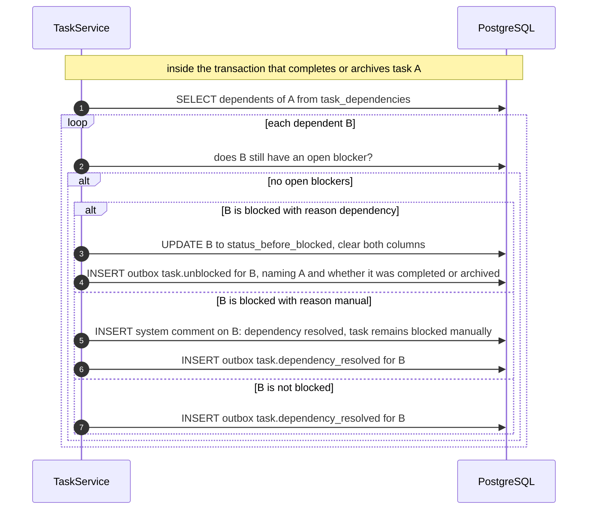

- The check and the status change run in the same transaction as the change to A, with actor kind `system`, so they never enqueue agent jobs.
- A manually blocked task is never unblocked by the system. If someone blocked a task because of a vendor outage, finishing an unrelated subtask leaves it blocked, with a comment saying the dependency is done.
- A dependent that is `in_progress` (it was started despite the dependency) keeps its status and gets `task.dependency_resolved`.
- **Restore.** If A is restored, its dependency rows are still there, so it counts as an open blocker again. Dependents still in `todo` are given a dependency block. Dependents that are `in_progress` or `completed` keep their status and get a system comment plus a high-priority `task.dependency_reopened` notification, so the assignee can judge whether the revived blocker matters.

**Outbox row.**

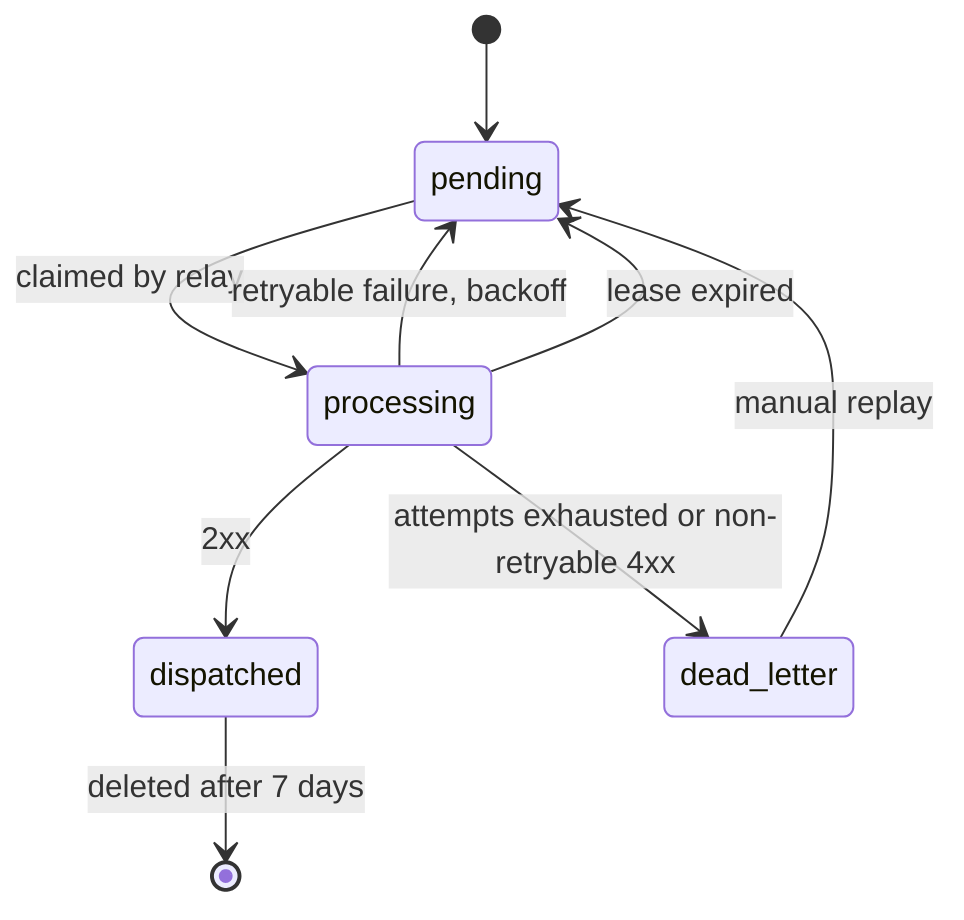

**Agent job.**

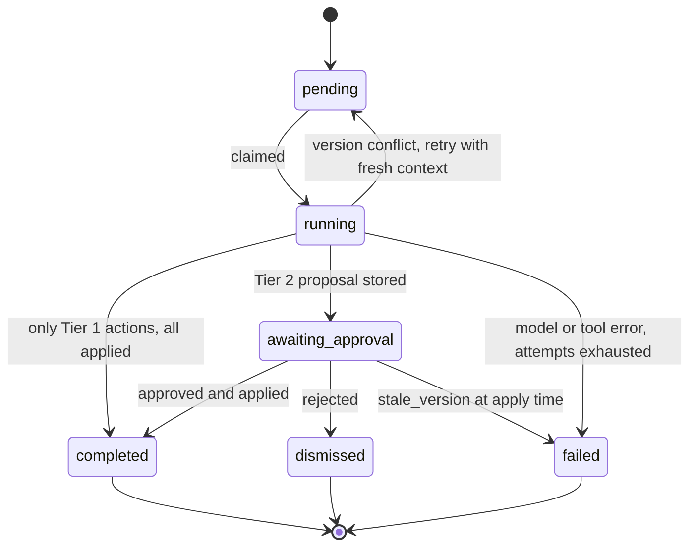

### 4.4 Idempotency and dedup keys

| Case | Key format |
| --- | --- |
| State mutation | `taskify:{tenant_id}:{task_id}:{event_type}:v{version}` |
| Mutation with several recipients | Same, with `:{user_id}` appended |
| Due soon | `taskify:{tenant_id}:{task_id}:due_soon_24h` and `...:due_soon_1h` |
| Overdue | `taskify:{tenant_id}:{task_id}:overdue:{YYYY-MM-DD}` |
| Approval request | `taskify:{tenant_id}:{job_id}:agent.approval_requested` |
| Agent job dedup | `{agent_type}:{task_id}:v{version}` for event-triggered jobs; `{agent_type}:{task_id}:stale:{YYYY-MM-DD}` for stale scans |

Changing `due_at` should reset `last_due_soon_notified_at`, and the due-soon key should then include the new due timestamp, otherwise a rescheduled task would never be reminded again. This is not covered in the source documents.

---

## 5. Low-level design

### 5.1 Package layout

```text
taskify/
├── contract/                        # R3: language-neutral definition, see 9.2
├── cmd/taskify/main.go              # wiring, graceful shutdown
├── cmd/taskctl/                     # R3: CLI, see 9.5
├── pkg/client/                      # R3: Go API client generated from the contract
├── sdk/python/                      # R3: Python client SDK, see 9.4
├── web/                             # R3: frontend, see 9.6; embed.go for optional embedding
├── tests/conformance/               # R3: black-box suite, see 9.3
├── internal/
│   ├── config/config.go             # env parsing and validation
│   ├── domain/
│   │   ├── task.go                  # Task, Comment, state machine
│   │   ├── event.go                 # event types, payload and key builders
│   │   ├── agentjob.go              # AgentJob, statuses, tiers (R2)
│   │   └── errors.go
│   ├── repository/
│   │   ├── repository.go            # interfaces
│   │   ├── postgres/                # db.go, task_repo.go, outbox_repo.go, agent_job_repo.go
│   │   └── memory/                  # in-memory fakes with the same interfaces
│   ├── service/
│   │   ├── task_service.go
│   │   ├── feedback_service.go
│   │   └── agent_job_service.go     # apply and dismiss (R2)
│   ├── worker/
│   │   ├── outbox_relay.go
│   │   ├── deadline_scheduler.go
│   │   └── outbox_cleanup.go
│   ├── agentpulse/
│   │   ├── client.go                # typed calls
│   │   └── breaker.go               # circuit breaker
│   ├── agent/                       # R2
│   │   ├── runtime.go               # job claim loop
│   │   ├── agent.go                 # Agent interface, shared reasoning loop
│   │   ├── llm/                     # client.go, mock.go
│   │   ├── tools/                   # registry.go and one file per tool
│   │   ├── triage.go
│   │   ├── decomposer.go
│   │   ├── blocker.go
│   │   ├── digest.go
│   │   └── learning.go
│   ├── api/
│   │   ├── router.go
│   │   ├── middleware.go
│   │   ├── task_handler.go
│   │   ├── webhook_handler.go
│   │   ├── admin_handler.go
│   │   └── agent_job_handler.go     # R2
│   └── observability/               # metrics.go, tracing.go
├── migrations/
│   ├── 000001_init_tasks.{up,down}.sql
│   ├── 000002_outbox.{up,down}.sql
│   └── 000003_agent_schema.{up,down}.sql
├── docker-compose.yml
└── Makefile
```

Dependency direction: `api` → `service` → `domain` and repository interfaces. `worker` and `agent` → `service`, repository interfaces, and adapters. `domain` imports nothing from the project.

### 5.2 Domain and service class diagram

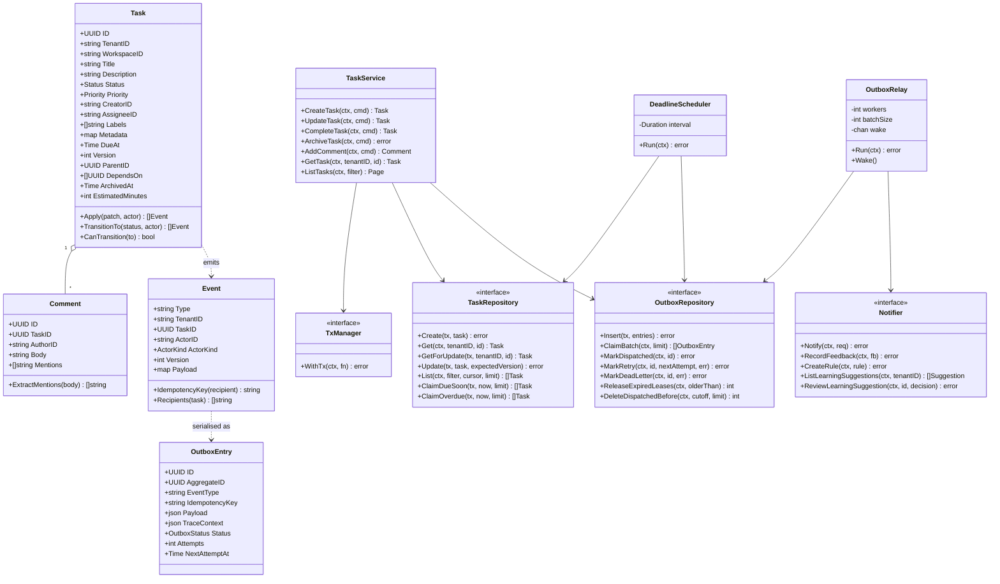

### 5.3 Agent runtime class diagram

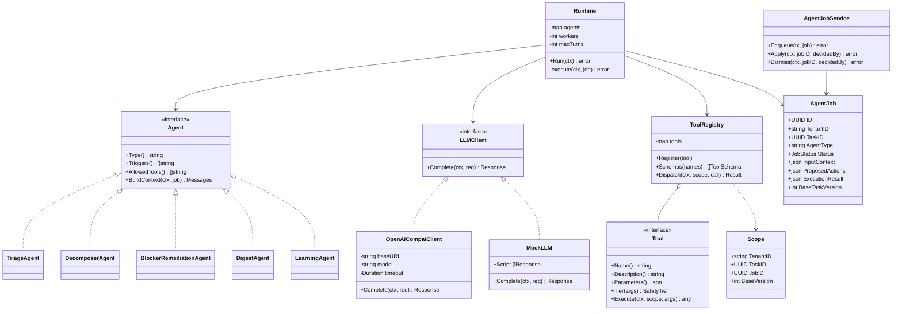

`Scope` is built from the job row, never from model output. A tool that receives a `task_id` argument outside the scope's tenant, or outside the job's task and its children, returns an error.

### 5.4 REST API

All routes are under `/api/v1`. Legacy `/tasks/` routes alias the task endpoints.

| Method and path | Purpose | Events or effects | Release |
| --- | --- | --- | --- |
| `POST /tasks` | Create task | `task.created`, `task.assigned` | R1 |
| `GET /tasks` | List with filters and cursor: `assignee_id`, `status`, `priority`, `limit`, `cursor` | none | R1 |
| `GET /tasks/{id}` | Task with watchers and recent comments | none | R1 |
| `PUT /tasks/{id}`, `PATCH /tasks/{id}` | Update; requires `If-Match` or `version` | `task.updated`, `task.assigned`, `task.priority_escalated`, `task.blocked` | R1 |
| `POST /tasks/{id}/complete` | Complete | `task.completed`; `acted` feedback if a notification ID is supplied | R1 |
| `DELETE /tasks/{id}` | Soft archive: sets `status = 'archived'`, `archived_at`, `updated_at` | none | R1 |
| `DELETE /tasks/{id}?permanent=true` | Permanent delete for data-scrubbing requests (admin only) | Removes the task and its dependent rows | R1 |
| `POST /tasks/{id}/comments` | Add comment, extract mentions, detect `/decompose` | `task.comment_added` | R1 |
| `POST /tasks/{id}/feedback` | Forward `acted`, `dismissed`, `snoozed`, `muted` | AgentPulse `/feedback` | R1 |
| `POST /webhooks/agentpulse` | Signed callbacks from AgentPulse | Task mutation plus feedback | R1 |
| `POST /workspaces/{id}/bootstrap-rules` | Register default rules | AgentPulse `/rules` | R1 |
| `GET /admin/learning/suggestions` | List M38 suggestions | proxy | R1 |
| `POST /admin/learning/suggestions/{id}/decision` | Approve or reject | proxy | R1 |
| `POST /tasks/{id}/decompose` | Queue decomposition; returns `202` with job ID | `agent_jobs` row | R2 |
| `GET /agent-jobs/{id}` | Job status, proposal, result | none | R2 |
| `POST /agent-jobs/{id}/apply` | Approve a Tier 2 proposal | Applies changes, emits events | R2 |
| `POST /agent-jobs/{id}/dismiss` | Reject a Tier 2 proposal | none | R2 |
| `GET /agent-jobs` | List jobs; filters `status`, `task_id`, `agent_type`. Feeds the approvals inbox. | none | R3 |
| `GET /tasks/{id}/subtasks` | Children of a task with their dependency links | none | R3 |
| `POST /tasks/{id}/restore` | Restore an archived task to `todo` | none | R1 |
| `POST /workspaces` | Create a workspace (admin). Tasks can only be created in an existing workspace. | Registers the default AgentPulse rules | R1 |
| `GET /workspaces/{id}/settings`, `PATCH /workspaces/{id}/settings` | Read and change workspace settings, including `agent_settings` (admin) | none | R1; agent fields from R2 |
| `GET /tasks/{id}/agent-runs` | Agent activity for a task, from `agent_jobs` and `agent_run_history` | none | R3 |
| `GET /admin/outbox` | List outbox rows; filter `status=dead_letter` | none | R3 |
| `POST /admin/outbox/{id}/replay` | Return a dead-letter row to `pending` | Row is retried | R3 |
| `GET /notifications/in-app` | Current user's in-app feed, proxied from AgentPulse and enriched with task data | none | R3 |
| `POST /notifications/{id}/ack` | Mark a notification read or dismissed | Local ack plus AgentPulse feedback | R3 |
| `GET /me` | Current user, tenant, and role | none | R3 |
| `GET /events` | Server-Sent Events stream | none | Later (live updates Phase 2) |
| `GET /healthz`, `GET /readyz`, `GET /metrics` | Operations (not under `/api/v1`) | none | R1 |

From R3, `GET /tasks` also accepts `updated_since` and `id_prefix`, and list endpoints honour `If-None-Match`.

The R3 rows exist because the CLI and frontend need to list things that R1 and R2 only expose one at a time.

**Permanent delete.** One transaction, in this order:

1. Delete `agent_jobs` rows for the task (their run history cascades).
2. Delete every `notification_outbox` row with that `aggregate_id`, in any status. The outbox has no foreign key to `tasks` and its `payload` holds the task title.
3. Delete the task. Foreign keys cascade to `task_dependencies`, `task_watchers`, and `task_comments`.
4. If no task row was deleted, return `ErrNotFound` and roll back.

Notes:

- Removing `pending` and `processing` rows stops the relay from sending a notification about a task that no longer exists. A relay worker that claimed a row a moment before the delete may still send it once; its later status update then matches no row and must be treated as success, not an error.
- Dependents of the deleted task lose that dependency row through the cascade. The unblock check from section 4.3 runs for them before the delete, in the same transaction.
- AgentPulse may still hold delivered notifications that contain the title. Taskify can write a `taskify.task_scrubbed` event after the delete, carrying only the task ID, so AgentPulse can mask its copy. This is optional and depends on AgentPulse having a way to act on it, which is not confirmed (M0).

Error mapping:

| Domain error | HTTP status |
| --- | --- |
| `ErrValidation`, `ErrInvalidStateTransition` | 400 or 422 |
| Missing or invalid credentials, bad webhook signature | 401 |
| `ErrNotFound` (including a task in another tenant) | 404 |
| `ErrVersionConflict` | 409 |
| Rate limit | 429 |

### 5.5 AgentPulse contract used by Taskify

The details below were supplied by the project owner (decisions 1, 5, 6). They have not been read from the AgentPulse repository, which is still not in this workspace, so M0 checks them against the SDK, the M37 `/notify` handler, and `14-learning-suggestions.json`. An example `/notify` body is in [initial.md](initial.md) section 4.C.2.

`/notify` fields, all camelCase:

| Field | Type | Notes |
| --- | --- | --- |
| `idempotencyKey` | string, required | |
| `tenantId` | string, required | |
| `userId` | string, required | Decided: `userId`, not `recipientId`. AgentPulse keys its budget and preferences on it. |
| `eventType` | string, required | |
| `title` | string, required | |
| `body` | string, required | |
| `channels` | string array | `slack`, `email`, `in_app`, `webhook`, and `digest` to force digest routing |
| `priorityHint` | string | `critical`, `high`, `medium`, `low` |
| `payload` | object | Free-form, plus the reserved keys below |

Reserved `payload` keys:

| Key | Effect |
| --- | --- |
| `bypassDigest: true` | Forces immediate dispatch. Taskify sets it for `p1_critical` and `task.blocked`. |
| `digestSummary` | Text the digest renderer uses for this item. Without it, AgentPulse shows `title` and timestamp. |
| `actionUrls` | Interactive actions |

All payload keys are camelCase. `bypass_digest` is a legacy spelling: the serializer always writes `bypassDigest`, and if a legacy rule or config supplies `bypass_digest`, the client adapter rewrites it to `bypassDigest` before sending.

Learning suggestion body for `POST /learning/suggestions`: `tenantId`, `ruleId` or `eventPattern`, `currentAdjustment`, `proposedAdjustment` (within ±20), `signalCount` (at least 5 signals from at least 2 users), `rationale`. AgentPulse stores it as `PENDING_APPROVAL` and changes nothing until an admin decides.

| Taskify call | AgentPulse endpoint | Key fields |
| --- | --- | --- |
| `Notify` | `/notify` | `idempotencyKey`, `tenantId`, `userId`, `source`, `eventType`, `title`, `body`, `priorityHint`, `channels`, `payload` (including `actionUrls`) |
| `RecordFeedback` | `/feedback` | notification ID, user, signal, optional snooze duration |
| `CreateRule` | `/rules` | `payloadMatch` or `eventType`, `channels`, digest bypass |
| `ListLearningSuggestions` | `/learning/suggestions` | tenant |
| `SubmitLearningSuggestion` (R2) | `POST /learning/suggestions` | See the body above |
| `ReviewLearningSuggestion` | `POST /learning/suggestions/{id}/decision` | `approve` or `reject` |
| Inbound | `POST /api/v1/webhooks/agentpulse` | `X-AgentPulse-Signature`, timestamp, action name, task or job ID, user |

Priority mapping for `priorityHint`: `p1_critical` → `critical`, `p2_high` → `high`, `p3_medium` → `medium`, `p4_low` → `low`.

### 5.6 Event taxonomy

| Event | Raised when | Recipients | Agent triggered |
| --- | --- | --- | --- |
| `task.created` | Task created with an assignee other than the creator | Assignee | Triage |
| `task.assigned` | `assignee_id` changes | New assignee | Digest gatekeeper |
| `task.updated` | Title, description, or due date changes | Assignee, watchers | Triage, if human-authored |
| `task.priority_escalated` | Priority moves upward | Assignee, watchers | none |
| `task.blocked` | Status becomes `blocked`. Payload carries `blockedReason`. | Assignee, watchers | Blocker, for manual blocks only |
| `task.dependency_resolved` (R2, new) | A dependency resolved but the task was not auto-unblocked (manually blocked, or already started) | Assignee | none |
| `task.dependency_added` (R2, new) | An unresolved dependency was added to a task that is already `in_progress`, so its status was left alone | Assignee | none |
| `task.dependency_reopened` (R2, new) | A resolved dependency became open again (blocker restored or reopened) for a task already started or completed. Sent with `priorityHint: high`. | Assignee | none |
| `task.due_soon` | Scheduler: 24 h and 1 h before `due_at` | Assignee | none |
| `task.overdue` | Scheduler: past `due_at`, not completed or archived | Assignee | none |
| `task.completed` | Status becomes `completed` | Creator, watchers | Dependency release |
| `task.comment_added` | Comment added | Assignee, watchers, mentioned users with `isMentioned: true` | Decomposer, on `/decompose` |
| `task.unblocked` (R2, new) | A dependency-blocked task was returned to its earlier status because all its dependencies are completed or archived | Assignee | none |
| `agent.approval_requested` (R2, new) | Agent job enters `awaiting_approval` | Assignee, or creator when unassigned | none |

The triage agent runs on every created task, including those where creator and assignee are the same and no notification is sent. The agent trigger is the task change, not the outbox row.

The actor is excluded from recipients: nobody is notified of their own action.

**Loop prevention.** Every event carries `ActorKind` (`user`, `agent`, `system`). Agent-authored changes still produce notifications but never enqueue agent jobs.

### 5.7 Tools and safety tiers

| Tool | Used by | Arguments | Tier |
| --- | --- | --- | --- |
| `UpdateTaskAttributes` | Triage | `task_id`, `labels`, `description`, `estimated_minutes`, `priority`, `reasoning` | Tier 1, except Tier 2 when `priority` is set |
| `LinkDependencies` | Triage, Blocker | `task_id`, `depends_on_task_ids` | Tier 1 |
| `CreateSubtaskDAG` | Decomposer | `parent_task_id`, `subtasks[]` with `title`, `description`, `depends_on` | Tier 1 (explicitly requested by a user) |
| `DraftResolutionComment` | Blocker | `task_id`, `body`, `reasoning` | Tier 1 |
| `ReassignTask` | Blocker | `task_id`, `assignee_id`, `reasoning` | Tier 2 |
| `ShiftDueDate` | Blocker, Digest | `task_id`, `due_at`, `reasoning` | Tier 2 |
| `ArchiveTask` | none by default | `task_id`, `reasoning` | Tier 2 |
| `ProposeNotificationRule` | Learning | rule definition, evidence | Tier 2, decided by an admin |

[agentic.md](agentic.md) is inconsistent on due dates: section 1 requires approval only for shifts over 24 hours, section 4.C for any postponement. This document takes the stricter reading.

**Workspace agent controls (decision 10).** `workspaces.agent_settings`:

```json
{
  "agents_enabled": true,
  "disabled_agents": ["decomposer"],
  "require_hitl_for_all": true,
  "max_subtasks_per_decomposition": 5
}
```

| Setting | Where it is checked | Effect |
| --- | --- | --- |
| `agents_enabled` | At job enqueue, inside the task transaction | When false, no `agent_jobs` row is written. A skipped-job counter is incremented. |
| `disabled_agents` | At job enqueue | Jobs for the listed agent types are not written. An explicit `POST /tasks/{id}/decompose` for a disabled agent returns an error instead of `202`. |
| `require_hitl_for_all` | In the tool registry | Every tool call is treated as Tier 2, including ones a user requested explicitly. |
| `max_subtasks_per_decomposition` | In `CreateSubtaskDAG` | A larger proposal is rejected and the model is asked once to reduce it. |

Defaults for a new workspace (decision 19): `agents_enabled: false`, `disabled_agents: []`, `require_hitl_for_all: true`, `max_subtasks_per_decomposition: 5`. Agents are opt-in so that no tenant incurs model costs or agent notifications without an admin choosing to. Note the second default: after an admin turns agents on, every agent action, including adding a label, still waits for approval until `require_hitl_for_all` is also turned off. The runtime checks the settings again when it claims a job, so a job queued before agents were switched off does not run.

Every Tier 1 execution appends to `tasks.agent_metadata`:

```json
{
  "runs": [
    {
      "job_id": "…",
      "agent": "triage",
      "at": "2026-11-11T09:30:00Z",
      "changes": {"labels": ["bug", "backend"], "estimated_minutes": 90},
      "reasoning": "Title mentions a crash in checkout on staging."
    }
  ],
  "priority_recommendation": {"value": "p1_critical", "job_id": "…"}
}
```

Reasoning loop limits: 30-second timeout per model call; retry with exponential backoff on 429 and 503; one repair turn for malformed output; a fixed maximum number of turns per job; a fixed maximum number of subtasks per decomposition.

### 5.8 Configuration

| Variable | Default | Purpose |
| --- | --- | --- |
| `PORT` | `8080` | HTTP listen port |
| `DATABASE_URL` | required | PostgreSQL connection string |
| `PUBLIC_BASE_URL` | required | Base for `actionUrls` in notifications |
| `AGENTPULSE_BASE_URL` | required | AgentPulse API |
| `AGENTPULSE_API_KEY` | required | Outbound authentication |
| `AGENTPULSE_WEBHOOK_SECRET` | required | HMAC key for inbound webhooks |
| `OUTBOX_WORKERS` | `8` | Relay concurrency |
| `OUTBOX_BATCH_SIZE` | `100` | Rows per claim |
| `OUTBOX_POLL_INTERVAL` | `200ms` | Relay ticker |
| `OUTBOX_MAX_ATTEMPTS` | `10` | Before dead-letter |
| `SCHEDULER_INTERVAL` | `1m` (proposed) | Deadline scan period |
| `ENV` | `production` | `development` enables the header identity fallback |
| `JWT_ALGORITHM` | `HS256` | `HS256` or `RS256` |
| `JWT_SECRET` or `JWT_PUBLIC_KEY` | required in production | Token verification key |
| `TRUSTED_GATEWAY_CIDRS` | empty | IP ranges allowed to send `X-Tenant-ID` and `X-User-ID` |
| `CORS_ALLOWED_ORIGINS` | empty | Frontend origins, when the frontend is deployed separately |
| `SERVE_EMBEDDED_SPA` | `false` | Serve the embedded frontend at `/` |
| `AGENTS_ENABLED` | `false` | Process-level switch for the agent runtime. Per-workspace control is in `agent_settings`. |
| `AGENT_WORKERS` | `4` (proposed) | Agent job concurrency |
| `LLM_BASE_URL` | none | OpenAI-compatible endpoint |
| `LLM_API_KEY` | none | Empty for local Ollama |
| `LLM_MODEL` | none | Model name. Development and CI: `qwen2.5-coder:7b` or `llama3.1:8b` on Ollama. Self-hosted production: a larger Qwen coder model on vLLM or TGI. Managed: any hosted model with tool calling. Switching is configuration only. |
| `LLM_TIMEOUT` | `30s` | Per-call timeout |

---

## 6. Cross-cutting concerns

### 6.1 Reliability

| Failure | Behaviour |
| --- | --- |
| AgentPulse down | Task writes succeed. Outbox rows accumulate and retry. The breaker opens for 10 seconds after more than 50% 5xx in a rolling 20-request window. |
| Relay crashes after AgentPulse accepted, before marking `dispatched` | Row is retried with the same idempotency key; AgentPulse deduplicates. |
| Relay crashes after claim | Lease reaper returns the row to `pending`. |
| Two replicas scan deadlines together | `SKIP LOCKED` plus unique `idempotency_key`. |
| Concurrent edits to one task | Second writer gets `409`. |
| LLM down or slow | Agent jobs retry, then fail. Task CRUD and notifications are unaffected. |
| LLM returns malformed output | One repair turn, then `failed`. No data changed. |
| Human edits a task while an agent is reasoning | Tool write fails on version; job re-runs with fresh context. |
| Human edits a task while a proposal awaits approval | Apply fails with `stale_version`. |
| Process shutdown | Stop accepting HTTP, cancel worker contexts, finish in-flight rows, close pool. |

Backoff: `next_attempt_at = now + random(0, min(60s, 500ms × 2^attempts))`. Retention: `dispatched` rows older than 7 days are deleted daily in batches of 5,000.

### 6.2 Performance targets

| Path | Target | How |
| --- | --- | --- |
| Task write | P95 under 15 ms, P99 under 30 ms | One local transaction, no remote calls |
| Task read | P95 under 8 ms | Composite index, keyset pagination on `(updated_at, id)` |
| Outbox dispatch | P95 under 150 ms, P99 under 400 ms | In-process wake-up plus 200 ms ticker; HTTP transport with `MaxIdleConnsPerHost: 64`, `IdleConnTimeout: 90s` |

These are targets from [initial.md](initial.md). Nothing has been measured.

The in-process wake-up only reaches the relay in the same replica. Other replicas pick the row up on their next 200 ms tick. Postgres `LISTEN/NOTIFY` is the option if cross-replica latency matters.

### 6.3 Observability

Metrics:

| Metric | Type | Labels |
| --- | --- | --- |
| `taskify_http_request_duration_seconds` | histogram | route, method, status |
| `taskify_outbox_pending_rows` | gauge | none |
| `taskify_outbox_dispatch_duration_seconds` | histogram | event_type, outcome |
| `taskify_outbox_dlq_total` | counter | event_type |
| `taskify_feedback_forwarded_total` | counter | signal |
| `taskify_agent_job_duration_seconds` (R2, proposed) | histogram | agent_type, outcome |
| `taskify_agent_llm_tokens_total` (R2, proposed) | counter | agent_type, direction |
| `taskify_agent_proposals_total` (R2, proposed) | counter | agent_type, decision |

Tracing: the handler stores the W3C `traceparent` in `notification_outbox.trace_context`. The relay restores it before calling AgentPulse, so one trace covers client, API, outbox, relay, and AgentPulse. Agent jobs carry the originating trace in `input_context`.

Logging: structured, with `request_id`, `tenant_id`, `task_id`, `job_id`, `trace_id`.

### 6.4 Security

- **Caller authentication (decision 2).**
  - Production: `Authorization: Bearer <token>`. Middleware verifies the JWT signature (HS256 or RS256) and reads `tenant_id` and `sub` (the user ID) into the request context under typed keys.
  - Development or gateway: when `ENV=development`, or the request comes from an address in `TRUSTED_GATEWAY_CIDRS`, `X-Tenant-ID` and `X-User-ID` are accepted without a token. With `ENV=production` and an untrusted source address, these headers are rejected.
  - The source address check must use the connection's peer address. `X-Forwarded-For` is caller-controlled and must not be trusted for this.
  - The webhook endpoint is the one exception: it authenticates by HMAC signature, not by JWT.
- **Approval ingress (decision 3).** Clicks in Slack or email reach Taskify only through the signed AgentPulse webhook. `POST /agent-jobs/{id}/apply` and `/dismiss` require a user JWT and are for the frontend and CLI.
- **Tenant isolation.** Repositories take `tenant_id` from the request context, never from the request body, and every query filters on it. A task in another tenant returns `404`.
- **Webhook authenticity.** `X-AgentPulse-Signature` is HMAC-SHA256 over timestamp and body, compared in constant time, with a 5-minute replay window.
- **Prompt injection.** Task titles, descriptions, and comments are user-controlled text that the model reads. The controls are structural, not prompt-based:
  - each agent sees only its own allowed tools;
  - tenant and task scope come from the job row, not from model arguments;
  - arguments are validated against JSON Schema;
  - high-impact actions require human approval;
  - turn and subtask counts are capped.
- **Secrets.** API keys and the webhook secret come from the environment and are never logged. `.env` is already git-ignored.
- **Data sent to the LLM.** Task content leaves Taskify when a hosted model is configured. A local model (Ollama or vLLM) keeps it in-house. This is a deployment decision per tenant.
- **Auditability.** `agent_run_history` records every model turn and tool call; `agent_jobs` records who approved or rejected each proposal.

### 6.5 Concurrency model

| Goroutine group | Count | Coordination |
| --- | --- | --- |
| HTTP server | per request | none |
| Outbox relay | `OUTBOX_WORKERS` | `SKIP LOCKED` on `notification_outbox` |
| Deadline scheduler | 1 per replica | `SKIP LOCKED` on `tasks` |
| Agent runtime | `AGENT_WORKERS` | `SKIP LOCKED` on `agent_jobs` |
| Outbox cleanup and lease reaper | 1 per replica | idempotent statements |

All workers take a `context.Context` cancelled on shutdown and are joined with an `errgroup` in `main`.

---

## 7. Where this document departs from the source documents

| Topic | Source | This document | Reason |
| --- | --- | --- | --- |
| Parent column | `parent_task_id` in prose, `parent_id` in SQL | `parent_id` | The SQL is the more specific definition |
| Dependencies | `blocked_by UUID[]` with a GIN index | `task_dependencies` join table | Decision 4: referential integrity, cheap reverse lookups, cycle checks in SQL |
| `archived_at` | not present | New column on `tasks` | Decision 8 |
| `workspaces` table | `workspace_id` is only a string on `tasks` | New table with a foreign key from `tasks`, holding `agent_settings` | Decisions 10 and 19 |
| `status_before_blocked` | not present | New nullable column on `tasks` | Decision 17 returns an unblocked task to "`in_progress` if previously started", which needs the earlier status recorded |
| `blocked_reason` | not present | New nullable column on `tasks`: `dependency` or `manual` | Decision 23 |
| More new events | not present | `task.dependency_resolved`, `task.dependency_added`, `task.dependency_reopened` | Decisions 17 and 23 |
| `todo` → `completed` | not specified | Allowed | Decision 18 |
| Restore | `archived` not described as reversible | `archived` → `todo`, with `POST /tasks/{id}/restore` | Decision 9 |
| Overdue column | `last_notified_overdue_at` and `last_overdue_notified_at` both appear | `last_overdue_notified_at` | Matches the DDL |
| Admin routes | `/admin/notification-suggestions` and `/admin/learning/suggestions` both appear | `/admin/learning/suggestions` | Matches the implementation prompt |
| `agent_jobs.status` | `pending` means both "queued" and "waiting for approval" | Adds `awaiting_approval` and `dismissed` | One status cannot serve the worker poll index and the approval gate; a worker would re-claim jobs waiting on a human |
| `agent_jobs.task_id` | `NOT NULL` | Nullable | Digest and learning agents are scoped to a user or tenant, not a task |
| `agent_jobs` extra columns | not present | `dedup_key`, `base_task_version`, `attempts`, `decided_by`, `decided_at` | Duplicate suppression, stale-proposal detection, retry accounting, audit |
| `agent_run_history` | Named in AG-102, no definition | Defined in section 4.1 | Needed for audit |
| `project_id` | Listed in the domain model, absent from the DDL | Omitted | Follows the DDL; add when projects exist |
| Task IDs | UUIDv7 in prose, `gen_random_uuid()` (v4) in DDL | UUIDv7 generated in Go; DDL default kept as fallback | Time-ordered keys index better |
| New events | not present | `task.unblocked`, `agent.approval_requested` | Required by the decomposer and HITL flows |
| Agent triggering | "via the Outbox or an internal event bus" | `agent_jobs` rows written in the task transaction | Same durability guarantee as the outbox with no extra infrastructure |
| HITL order | AG-106 is P1, after triage | Before triage | Triage proposes priority changes, which need approval |
| Due-date shifts | Approval for shifts over 24 h in one place, for any postponement in another | Any shift needs approval | Stricter reading |

---

## 8. Decisions

### 8.1 Decided

Decided by the project owner on 2026-11-11. Each is applied in the section named. Numbers are kept from when the questions were first raised, so the open list below is not in sequence.

| # | Question | Decision | Applied in |
| --- | --- | --- | --- |
| 1 | Does the AgentPulse contract match? | Field names match and are camelCase. `priorityHint` values are `critical`, `high`, `medium`, `low`. The recipient field is `userId`. | 5.5 |
| 2 | How do callers authenticate? | JWT bearer in production with `tenant_id` and `sub` claims. `X-Tenant-ID` and `X-User-ID` headers only in development or from a trusted gateway address range. | 6.4, 5.8 |
| 3 | Where do approvals arrive? | Slack and other channel clicks through the signed AgentPulse webhook. Direct `apply` and `dismiss` endpoints require a user JWT, for frontend and CLI. | 6.4, 3.7 |
| 4 | Array or join table for dependencies? | `task_dependencies` join table, from the start. | 4.1, 4.2, 4.3 |
| 5 | Can Taskify force digest routing and supply digest text? | Yes: `channels: ["digest"]` forces digest, `payload.bypassDigest` (camelCase) forces immediate, `payload.digestSummary` supplies the text. | 5.5 |
| 6 | Does AgentPulse accept external learning suggestions? | Yes, through `POST /learning/suggestions`. They stay `PENDING_APPROVAL` until an admin decides. | 5.5 |
| 7 | Which model and hosting? | Ollama locally for development and CI. Production behind the OpenAI-compatible client, pointed at self-hosted vLLM or TGI where data must stay in-house, or a managed model otherwise. | 5.8 |
| 8 | Soft or hard delete? | Soft archive by default, setting `archived_at`. Permanent delete only through an admin-restricted `?permanent=true`. | 5.4 |
| 9 | Status transitions? | The matrix in section 4.3, enforced in the domain layer with `ErrInvalidStateTransition`. Amended by decision 18. | 4.3 |
| 10 | Per-workspace agent control? | `agent_settings` JSON on the workspace: master switch, per-agent disable list, force approval for everything, subtask cap. | 5.7, 4.2 |
| 11 | Python server or Python SDK? | SDK only. One Go server; the Python SDK is generated from `openapi.yaml` with a thin client on top. No second backend. | 9.1, 9.4 |
| 12 | How is parity kept across servers? | Not needed now. If a second server is ever built: Go is the reference, a black-box fixture-driven suite runs against both, and CI blocks merges unless both pass. | 9.3 |
| 13 | Where does the frontend read in-app notifications? | Through a Taskify proxy, `GET /api/v1/notifications/in-app`, with `POST /api/v1/notifications/{id}/ack`. The browser never calls AgentPulse. | 9.6 |
| 14 | How do live updates arrive? | Phase 1: polling with `ETag` and `304`. Phase 2: Server-Sent Events on `GET /api/v1/events`. No WebSockets. | 9.6 |
| 15 | How is the frontend deployed? | Separately on a CDN or static host in production. Optionally embedded in the Go binary with `go:embed`, switched on by `SERVE_EMBEDDED_SPA=true`, for local and self-hosted use. | 9.6 |
| 16 | CLI language? | Go, with `spf13/cobra` and `spf13/viper`. | 9.5 |
| 17 | Is a task still blocked when its blocker is archived? | No. A dependency is resolved when its target is `completed` or `archived`. The dependency row is kept. Dependents are re-checked, moved out of `blocked`, and sent `task.unblocked`. On restore the dependency is live again. | 4.3 |
| 18 | "Mark done" on a task that was never started? | Allowed: `todo` → `completed` is added to the matrix. No synthetic step through `in_progress`. | 4.3 |
| 19 | Workspace entity and agent defaults? | `workspaces` table with a foreign key from `tasks`. Agents default to off; approval for everything defaults to on. Endpoints `GET` and `PATCH /workspaces/{id}/settings`. | 4.2, 5.4, 5.7 |
| 20 | How does the event stream authenticate? | Streaming `fetch` with the normal bearer header. Never a JWT in the URL. A single-use 30-second ticket exchange is the fallback if a client needs native `EventSource`. | 9.6 |
| 21 | Where is the Python SDK published? | For M15, installed from a Git tag and subdirectory (`sdk/python`). No public wheels until v1.0. The public package name is reserved now. | 9.4 |
| 22 | CLI binary name? | `taskctl` for the CLI, `taskify` for the server. | 9.5 |
| 23 | Can auto-unblock override a manual block? | No. A `blocked_reason` column (`dependency` or `manual`) is added; only dependency blocks are lifted automatically. | 4.3 |
| 24 | `CASCADE` or `RESTRICT` on the workspace foreign key? | `ON DELETE RESTRICT`. | 4.2 |
| 26 | Python SDK package name? | Distribution name `taskify-sdk`, imported as `taskify`. Reserving the name on the public index is an owner action. | 9.4 |
| 25 | Permanent delete and the outbox? | One transaction deletes agent jobs, all outbox rows for the task, then the task. Optional `taskify.task_scrubbed` event for AgentPulse. | 5.4 |

### 8.2 Open

None at present. What remains unverified is the AgentPulse contract, which milestone M0 checks against the AgentPulse code (see [milestones.md](milestones.md), M0).

---

## 9. Clients and portability

This section covers release R3: the contract, the Python client SDK, the CLI, and the web frontend. It follows decisions 11 to 16 in section 8.1; the open questions are items 20 to 22 in section 8.2.

### 9.1 Overview

There is one server, written in Go. Everything else is a client of its REST API (decision 11).

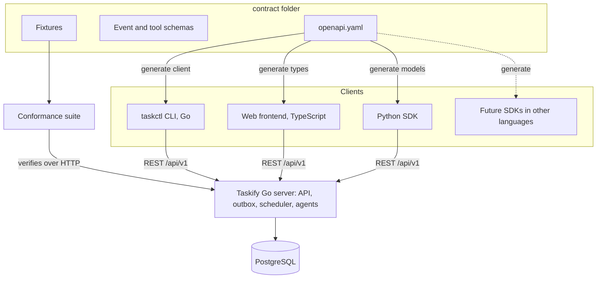

"Other languages going forward" therefore means more generated SDKs, each a few days of work, not more servers.

### 9.2 Language-neutral contract

```text
contract/
├── openapi.yaml             # every endpoint, schema, and error body
├── events/                  # one JSON Schema per event payload
├── tools/                   # agent tool parameter schemas
├── fixtures/                # declarative request and expectation files
└── RULES.md                 # rules a schema cannot express
tests/
└── conformance/             # runner that executes the fixtures against TARGET_URL
```

| Artifact | Normative for | Consumed by |
| --- | --- | --- |
| `openapi.yaml` | Paths, methods, request and response bodies, status codes | Go response validation in CI, `pkg/client`, frontend types, Python SDK models |
| `events/*.schema.json` | Outbox payload shape | Server tests |
| `tools/*.schema.json` | What the LLM may request | The tool registry loads these at start-up |
| `fixtures/*.json` | Request, expected status, headers, body schema, and expected outbox events with idempotency keys | Conformance runner |
| `migrations/*.sql` | Database schema | The server |
| `RULES.md` | Everything else: key formats, transitions, tiers, timestamp and UUID formatting | People, and the fixtures that encode it |

The Go service is the reference implementation. `openapi.yaml` and the migrations live only in this repository.

Rules every client must respect:

- **Timestamps** are RFC 3339 in UTC with a `Z` suffix.
- **Field names** are snake_case in the Taskify API. (AgentPulse payloads are camelCase, but clients never see those.)
- **Updates carry a version.** Clients send `If-Match` and handle `409`.
- **Unknown fields** in a response are ignored, not treated as errors, so an older client survives a newer server.

### 9.3 Conformance suite

A black-box runner that knows only a URL:

```bash
TARGET_URL=http://localhost:8080 go test -v ./tests/conformance/...
```

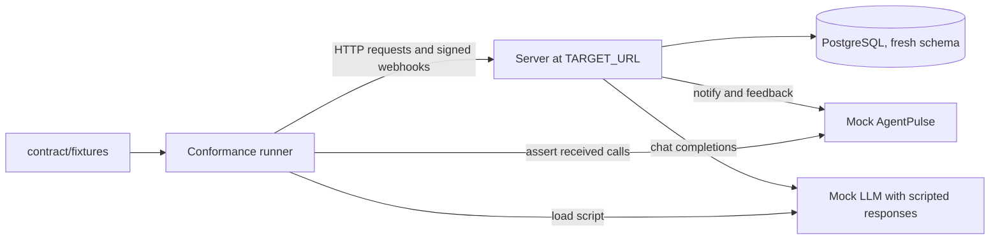

Each fixture states the request, the expected status, headers, and response schema, and the outbox events the request must produce. Outbox assertions are made through `GET /admin/outbox` and through what the mock AgentPulse received, so the runner needs no database access.

| Group | Examples |
| --- | --- |
| Task API | CRUD, pagination, validation errors, `409` on stale version, tenant isolation, archive and restore |
| Transitions | Every cell of the matrix in section 4.3 |
| Events | Each change produces the expected events with the expected keys and recipients |
| Delivery | Mock AgentPulse returns 503 then 200: exactly one accepted notification; ten failures: dead letter |
| Webhooks | Valid signature accepted; bad signature and stale timestamp rejected |
| Auth | Missing, expired, and wrongly signed tokens; header fallback refused in production |
| Agents | Scripted Tier 1 call changes the task; Tier 2 call waits for approval; malformed output changes nothing |
| HITL | Apply, dismiss, double-apply, stale version |

With one server, the suite's job is to keep the server honest to the contract that the CLI, frontend, and SDK are generated from.

**If a second server is ever built (decision 12).** Go stays the reference. The same suite runs against both targets, and CI blocks any merge that changes business logic, transitions, or the API unless the suite passes on both containers. This is recorded so the rule exists before it is needed; no second server is planned.

### 9.4 Python client SDK

A typed Python package for scripts, data pipelines, notebooks, and external agent workflows. It contains no business logic: the server remains the only place where transactions, locking, the outbox, and agents live.

```text
sdk/python/
├── pyproject.toml
├── src/taskify/
│   ├── __init__.py
│   ├── _generated/          # Pydantic models generated from openapi.yaml, never hand-edited
│   ├── client.py            # TaskifyClient (sync) and AsyncTaskifyClient
│   ├── resources/           # tasks.py, comments.py, agent_jobs.py, admin.py, notifications.py
│   ├── errors.py            # typed exceptions
│   ├── pagination.py        # iterators over cursor pages
│   └── auth.py              # token providers
└── tests/
```

| Topic | Design |
| --- | --- |
| Generation | Models from `openapi.yaml` with `datamodel-code-generator`; a thin hand-written client on `httpx` on top. CI regenerates and fails if the committed models differ. |
| Python version | 3.10 or later |
| Sync and async | Both, sharing the same resource definitions |
| Authentication | Bearer token passed in, or read from `TASKIFY_TOKEN`; a callable can supply refreshed tokens |
| Errors | One exception per error code in section 5.4: `NotFoundError`, `VersionConflictError` (carries the current version), `ValidationError`, `AuthError`, `RateLimitError` |
| Versions | `update()` takes the task object and sends its `version` as `If-Match`. No silent retry on conflict. |
| Pagination | `client.tasks.list(...)` returns an iterator that follows cursors |
| Retries | Idempotent requests (`GET`) retry on connection errors, 429, and 503 with backoff. Writes do not retry automatically. |
| Async jobs | `client.tasks.decompose(id)` returns a job; `job.wait(timeout=...)` polls until it leaves `pending` and `running` |
| Compatibility | Sends its version in `User-Agent`; ignores unknown response fields |
| Distribution (decision 21) | For M15, installed from a Git tag and subdirectory. No public wheels until v1.0, when the REST contract is stable; until then releases are GitHub Releases or internal wheels only. The distribution name is `taskify-sdk` and the import name is `taskify` (decision 26). Reserving `taskify-sdk` on the public index is done by the project owner. |

Install during M15:

```bash
pip install "git+https://github.com/RONGALI-TARUN/taskify.git@v0.1.0#subdirectory=sdk/python"
```

The SDK shares the repository's tags with the Go module, so an SDK release and a server release carry the same version number.

Usage:

```python
from taskify import TaskifyClient, VersionConflictError

client = TaskifyClient(base_url="https://taskify.example", token=token)

task = client.tasks.create(title="Fix checkout crash on staging", priority="p2_high")

for t in client.tasks.list(status="blocked"):
    print(t.id, t.title)

try:
    client.tasks.update(task, priority="p1_critical")
except VersionConflictError as e:
    task = client.tasks.get(task.id)   # someone else changed it; decide what to do
```

A Python agent built by another team uses this SDK like any other caller. It acts with its user's permissions through the public API and does not get the internal tool registry or bypass approval rules.

### 9.5 CLI: `taskctl`

Written in Go with `spf13/cobra` for commands and `spf13/viper` for configuration (decision 16), on top of `pkg/client`. It talks only to the REST API. It may import validation constants and error codes from `internal/domain`, since it lives in the same module, so priority names and status values are not duplicated.

**Command tree.**

```text
taskctl
├── login                         # store credentials for a profile
├── config
│   ├── view
│   ├── set <key> <value>
│   └── use-profile <name>
├── task
│   ├── add <title> [--desc --priority --assignee --due --label ...]
│   ├── list [--status --priority --assignee --mine --limit]
│   ├── show <id> [--comments --subtasks --agent-runs]
│   ├── update <id> [--title --desc --priority --assignee --due --status]
│   ├── done <id>
│   ├── block <id> [--reason]
│   ├── unblock <id>
│   ├── archive <id>
│   ├── comment <id> <text>
│   └── decompose <id> [--wait]
├── job
│   ├── list [--status awaiting_approval --task]
│   ├── show <id> [--watch]
│   ├── approve <id>
│   └── reject <id>
├── admin
│   ├── suggestions list
│   ├── suggestions decide <id> --approve | --reject
│   ├── rules bootstrap <workspace>
│   ├── outbox list [--status dead_letter]
│   └── outbox replay <id>
├── completion <shell>
└── version
```

**Behaviour.**

| Topic | Design |
| --- | --- |
| Output | Aligned table for people; `--json` prints the API response body unchanged for scripts; `--quiet` prints only IDs |
| Config | `config.yaml` in the user config directory, with named profiles: `server`, `tenant`, `workspace`, credential reference |
| Precedence | Flag, then environment variable (`TASKIFY_SERVER`, `TASKIFY_TOKEN`, `TASKIFY_PROFILE`), then profile |
| Credentials | Stored in the operating system keychain where available, otherwise a file readable only by the user. Never echoed. |
| Versions | `update` reads the task, applies the change, and sends `If-Match`. On `409` it reports the conflict and does not retry blindly. |
| IDs | Accepts a full UUID or a unique prefix |
| Async commands | `decompose` returns the job ID at once; `--wait` polls until the job leaves `pending` and `running` |
| Compatibility | Sends its version in `User-Agent`; warns if the server's API version is newer than it understands |

**Exit codes.**

| Code | Meaning |
| --- | --- |
| 0 | Success |
| 1 | Unexpected error |
| 2 | Usage error |
| 3 | Authentication or permission failure |
| 4 | Not found |
| 5 | Version conflict |
| 6 | Server unreachable |

**Example flow.**

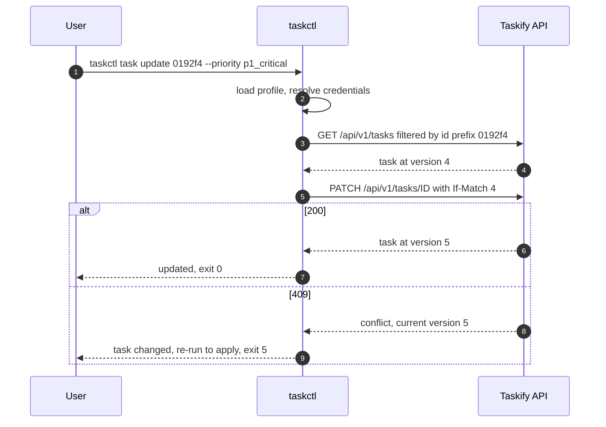

ID-prefix lookup needs an `id_prefix` filter on the list endpoint; it is part of the M12 contract additions.

### 9.6 Web frontend

**Stack.** React with TypeScript, built with Vite. Server state through TanStack Query. Routing with React Router. API types generated from `openapi.yaml`, so a contract change that breaks the UI fails the type check. These are suggested choices; nothing in the backend depends on them.

**Structure.**

```mermaid
flowchart TB
    subgraph browser["Browser"]
        subgraph pagesG["Pages"]
            tasksP["Task list and board"]
            detailP["Task detail"]
            inboxP["Approvals inbox"]
            briefP["Morning brief"]
            adminP["Admin"]
        end
        subgraph sharedG["Shared"]
            comps["UI components"]
            depGraph["Dependency graph view"]
            timeline["Agent activity timeline"]
        end
        subgraph dataG["Data layer"]
            queryC["Query cache"]
            apiC["Typed API client, generated"]
            authC["Auth and session"]
        end
    end
    api["Taskify API"]

    pagesG --> sharedG
    pagesG --> queryC
    queryC --> apiC
    apiC --> authC
    apiC -->|"REST /api/v1"| api
```

```text
web/
├── package.json
├── src/
│   ├── api/            # generated types and client
│   ├── auth/
│   ├── pages/          # tasks, task-detail, approvals, brief, admin
│   ├── components/
│   ├── hooks/
│   └── main.tsx
└── e2e/                # browser tests
```

**Screens.**

| Screen | Shows | Endpoints | Needs |
| --- | --- | --- | --- |
| Task list | Filterable, paginated list; quick add | `GET /tasks`, `POST /tasks` | R1 |
| Board | Columns by status; drag to change status | `GET /tasks`, `PATCH /tasks/{id}` | R1 |
| Task detail | Fields, comments, watchers, feedback actions | `GET /tasks/{id}`, `PATCH`, `POST .../comments`, `POST .../complete` | R1 |
| Subtasks and dependencies | Children and a graph of dependency links; Decompose button | `GET /tasks/{id}/subtasks`, `POST .../decompose` | M8 |
| Agent activity | Per-task timeline: which agent, what changed, reasoning, proposal status | `GET /tasks/{id}/agent-runs` | M5 |
| Approvals inbox | Proposals awaiting the user, with before and after values | `GET /agent-jobs?status=awaiting_approval`, `POST .../apply`, `POST .../dismiss` | M6 |
| Morning brief | Top three items, pending approvals, newly unblocked | Digest content | M10 |
| Notifications | In-app notification feed with act, snooze, dismiss | `GET /notifications/in-app`, `POST /notifications/{id}/ack` | M14 |
| Admin: learning | Suggestions with evidence; approve or reject | `GET /admin/learning/suggestions`, `POST .../decision` | R1 |
| Admin: delivery | Dead-letter rows with last error; replay | `GET /admin/outbox`, `POST .../replay` | M12 |
| Admin: agents | Job list, run history, token use | `GET /agent-jobs`, `GET /tasks/{id}/agent-runs` | M5 |

**Edit with conflict handling.**

```mermaid
sequenceDiagram
    autonumber
    participant U as User
    participant P as Task detail page
    participant Q as Query cache
    participant A as Taskify API

    U->>P: change priority
    P->>Q: optimistic update, keep previous value
    Q->>A: PATCH /api/v1/tasks/ID with If-Match version
    alt 200
        A-->>Q: task with new version
        Q-->>P: confirm
    else 409
        A-->>Q: conflict
        Q->>Q: roll back to previous value
        Q->>A: GET /api/v1/tasks/ID
        A-->>Q: latest task
        Q-->>P: show latest, tell the user their change was not saved
    end
```

**Design points.**

| Topic | Design |
| --- | --- |
| Authentication | JWT, per decision 2. Sign-in redirects to the identity provider; the token is held in memory with a refresh cookie that is `HttpOnly`, not in local storage. |
| Tenant and role | Read from the token. Admin pages are hidden for non-admins, and the server still enforces access. |
| Live updates | Phase 1: polling every 15 to 30 seconds with conditional requests. Phase 2: Server-Sent Events. No WebSockets. Detail below. |
| Agent changes | Always labelled with the agent name and reasoning from `agent_metadata`. A proposal shows current and proposed values side by side. |
| Untrusted text | Task and comment text is rendered as text, never as HTML. Markdown, if added, goes through a sanitiser. Agent-written text is treated the same way. |
| Errors | Each API error code in section 5.4 maps to a specific message; `409` gets the reload flow above. |
| Accessibility | Keyboard reachable, visible focus, labelled controls. Board drag-and-drop has a non-drag alternative. |
| Layout | Usable at phone width for list, detail, and approvals. Admin pages may assume a wider screen. |

**Backend changes the frontend requires.**

- CORS: allowed origins from a `CORS_ALLOWED_ORIGINS` variable. Not needed if the frontend is served from the same origin.
- The list endpoints added in section 5.4 (R3 rows).
- A `GET /api/v1/me` endpoint returning the current user, tenant, and role.
- Consistent error bodies: `{"error": {"code": "...", "message": "...", "details": {...}}}`, defined once in `openapi.yaml`.
- Rate limits that allow for polling.
- The notification feed proxy, conditional requests, and optional embedded serving described below.

**In-app notification feed (decision 13).** The browser never talks to AgentPulse. It holds only a Taskify JWT.

```mermaid
sequenceDiagram
    autonumber
    participant W as Web frontend
    participant T as Taskify API
    participant AP as AgentPulse
    participant DB as PostgreSQL

    W->>T: GET /api/v1/notifications/in-app with user JWT
    T->>T: verify JWT, take tenant and user from the token
    T->>AP: GET in-app feed for tenant and user, with service credentials
    alt AgentPulse answers
        AP-->>T: raw notifications
        T->>DB: load referenced tasks and local ack state
        T-->>W: notifications with task link, assignee, labels, read flag
    else timeout or breaker open
        T-->>W: 503 with a retry hint, the rest of the page keeps working
    end
    W->>T: POST /api/v1/notifications/ID/ack with signal acted or dismissed
    T->>DB: record ack
    T->>AP: POST /feedback
    T-->>W: 200
```

- The AgentPulse feed endpoint was given as `GET /internal/v1/tenants/{tenantId}/users/{userId}/in-app-feed`, with service-to-service authentication (mTLS or a shared secret). Both are to be verified in M0.
- Tenant and user in that call come from the verified token, never from the request, so one user cannot read another's feed.
- Ack state is stored in a small table, `notification_acks (tenant_id, user_id, notification_id, signal, acked_at)`, added in migration `000004`. The ack is saved locally first; if forwarding the feedback to AgentPulse fails, it is retried through the outbox instead of failing the click.
- This is a synchronous call to AgentPulse on a read path. It has a short timeout and uses the circuit breaker. Task reads and writes do not depend on it.

**Live updates (decision 14).**

| Phase | Mechanism | Latency | When |
| --- | --- | --- | --- |
| 1 | Polling every 15 to 30 seconds with `ETag` and `If-None-Match`, and `GET /tasks?updated_since=<timestamp>` for deltas | 15 to 30 s | M14 |
| 2 | Server-Sent Events on `GET /api/v1/events` | Under a second | Later, when watching an agent work live matters |
| not used | WebSockets | | Two-way framing and reconnection logic are not needed for one-way updates |

- Phase 1: the `ETag` for a list is derived from a cheap query (row count and latest `updated_at` for the filter), so an unchanged list returns `304` without loading or serialising rows. It still costs one small query.
- Phase 2: the server fans out Postgres `LISTEN/NOTIFY` messages to connected clients, filtered by tenant and user. Taskify has no Redis of its own, so Postgres is the default source.
- Phase 2 authentication (decision 20): the frontend reads the stream with streaming `fetch` and the normal `Authorization: Bearer` header, for example through `@microsoft/fetch-event-source`, which also handles reconnection and backoff. The browser's built-in `EventSource` is not used because it cannot send that header. A JWT is never put in the URL.
- If a third-party client ever needs native `EventSource`, the fallback is a ticket exchange: `POST /api/v1/auth/sse-ticket` with bearer auth returns a random single-use ticket valid for 30 seconds, used as `/api/v1/events?ticket=...`. This is not built until someone needs it. Tickets are stored in Postgres, not Redis, so Taskify gains no new infrastructure:

  ```sql
  CREATE UNLOGGED TABLE sse_tickets (
      ticket_id UUID PRIMARY KEY DEFAULT gen_random_uuid(),
      tenant_id VARCHAR(64) NOT NULL,
      user_id VARCHAR(128) NOT NULL,
      expires_at TIMESTAMPTZ NOT NULL DEFAULT (NOW() + INTERVAL '30 seconds')
  );
  CREATE INDEX idx_sse_tickets_expiry ON sse_tickets (expires_at);

  -- Consume: single use, rejected if no row comes back
  DELETE FROM sse_tickets
  WHERE ticket_id = $1 AND expires_at > NOW()
  RETURNING tenant_id, user_id;
  ```

  A background ticker deletes rows more than 5 minutes past expiry. An unlogged table is emptied after a database crash and is not copied to read replicas; both are acceptable for 30-second tickets, but the consume query must run on the primary.
- Archived tasks never appear in a normal list, so a delta poll alone would not tell the client that a task was archived. The `updated_since` response includes the IDs of tasks archived since that time.

**Deployment (decision 15).**

| Mode | How | Used for |
| --- | --- | --- |
| Separate | Vite `dist/` on an object store and CDN, or Nginx. Calls the API on its own origin, so `CORS_ALLOWED_ORIGINS` must list the frontend origin. | Production. A UI fix ships without rebuilding or restarting the Go service. |
| Embedded | The build is compiled into the Go binary with `go:embed` and served at `/` when `SERVE_EMBEDDED_SPA=true`. Same origin, so no CORS. | Local development, on-premises and self-hosted installs. |

Embedding notes:

- `go:embed` can only reference files at or below the directory of the Go file that declares it. The embed declaration therefore lives in `web/embed.go`, next to `web/dist/`, and `cmd/taskify` imports that package.
- A plain `go build` must not fail when the frontend has not been built. The embed sits behind a build tag (for example `-tags embedspa`), with a stub used otherwise.
- The file server falls back to `index.html` for unknown paths so client-side routes work, but never for paths under `/api/`.


### 9.7 Adding another language later

A new language means a new client SDK, not a new server.

1. Generate request and response types from `contract/openapi.yaml`.
2. Add a thin client: authentication, typed errors, cursor pagination, `If-Match` on updates.
3. Follow the client rules in section 9.2.
4. Test it against a running server, using the same scenarios as the Python SDK tests.
5. Add a CI job that regenerates the types and fails when they drift from the contract.

The Python SDK is the template. If a second server is ever proposed, section 9.3 and decision 12 describe the conditions.
