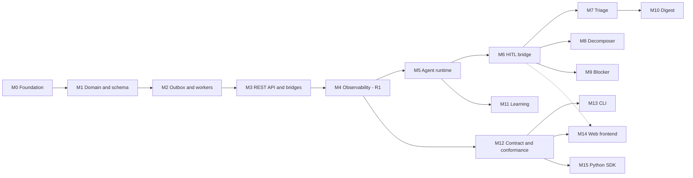

# Taskify Milestones

Companion documents: [features.md](features.md) (what and why) and [architecture.md](architecture.md) (how). Feature IDs (F1 to F8, A1 to A5) refer to [features.md](features.md). `AG-` IDs refer to the backlog in [agentic.md](agentic.md). `T` IDs refer to the phases in [initial.md](initial.md).

## Starting point

The repository contains a `main.go` that prints a greeting, an uncompilable router stub in `internal/router/routes.go`, and a `go.mod` with module path `taskify`. There is no database, no handlers, and no tests. Every milestone below is new work.

## Overview

Three releases. **R1** makes Taskify an attention-aware task service (M0 to M4). **R2** adds the agentic plane (M5 to M11). **R3** adds the contract, the CLI, the web frontend, and the Python client SDK (M12 to M15). R3 does not have to wait for R2: M12 can start as soon as R1 ships, and R3 work can run alongside the agents.

| # | Milestone | Delivers | Source | Estimate | Depends on |
| --- | --- | --- | --- | --- | --- |
| M0 | Foundation and reconnaissance | Project skeleton, tooling, AgentPulse contract confirmed | T Phase 0 | 1 to 2 days | none |
| M1 | Domain model and schema | F1, F2 | T1, T2 | 2 to 3 days | M0 |
| M2 | Outbox, AgentPulse client, workers | F3, F4 | T3 | 4 to 5 days | M1 |
| M3 | REST API, feedback, admin bridge | F5, F6, F7 | T4 | 3 to 4 days | M2 |
| M4 | Observability and hardening (**R1**) | F8 | T5 | 3 days | M3 |
| M5 | Agent runtime and schema | Job queue, LLM client, tool registry | AG-101, AG-102 | 4 days | M4 |
| M6 | Human-in-the-loop bridge | Approve and reject flow | AG-106 | 1 to 2 days | M5 |
| M7 | Triage agent | A1 | AG-103 | 2 days | M6 |
| M8 | Decomposer agent | A3 | AG-104 | 2 to 3 days | M6 |
| M9 | Blocker agent (**R2 core**) | A2 | AG-105 | 2 days | M6 |
| M10 | Digest agent | A4 | AG-107 | 2 days | M7 |
| M11 | Learning agent (**R2 complete**) | A5 | AG-108 | 3 to 4 days | M4, M5 |
| M12 | Contract and conformance suite | C1 | new | 3 to 4 days | M4 |
| M13 | CLI `taskctl` | C3 | new | 3 to 4 days | M12 |
| M14 | Web frontend (**R3 complete**) | C4 | new | 10 to 14 days | M12; approvals screens need M6 |
| M15 | Python client SDK | C2 | new | 2 days | M12 |

Total: roughly 29 to 36 working days for R1 and R2, plus 18 to 24 for R3, for one engineer. The `AG-` estimates are from [agentic.md](agentic.md). The M0 to M4 and M12 to M15 estimates are mine and have not been validated against real velocity; the frontend figure is the least certain.

There is no second server. An earlier draft planned a full Python implementation (two milestones, 12 to 16 days); it was replaced by the SDK on 2026-11-11.

The dotted line means a partial dependency: the frontend can start after M12, but its approvals and agent-activity screens need the HITL bridge.

One ordering change from the source backlog: the HITL bridge (AG-106, listed as P1) is scheduled before the triage agent (AG-103, listed as P0). Triage recommends priority changes, and [agentic.md](agentic.md) classes priority changes as approval-required, so triage cannot be finished without the approval flow.

M7, M8, and M9 are independent of each other and can run in parallel if more than one person is available.

---

## R1: Attention-aware task service

### M0. Foundation and reconnaissance

**Goal:** A project that builds, tests, and runs locally, with the AgentPulse contract known.

Deliverables:

- Module path changed to `github.com/RONGALI-TARUN/taskify`; binary output `bin/taskify`; README naming made consistent.
- Entrypoint moved to `cmd/taskify/main.go`; package layout from [architecture.md](architecture.md) section 5.1 created.
- `internal/config` loading environment variables with validation.
- `Makefile` targets: `build`, `test`, `lint`, `migrate-up`, `migrate-down`, `run`.
- `docker-compose.yml` with Postgres, Redis, AgentPulse, and Taskify.
- Migration tooling chosen and wired (for example `golang-migrate`).
- CI running `go vet`, lint, and `go test -race ./...`.
- A written note of AgentPulse's actual request and response shapes for `/notify`, `/rules`, `/preferences`, `/feedback`, `/digests`, `/learning/suggestions`.

Exit criteria:

- `make build` and `make test` pass on a clean clone.
- `docker compose up` starts all services and Taskify answers `GET /healthz`.
- Every field name in [architecture.md](architecture.md) section 5.5 is confirmed against the AgentPulse repository or SDK, or corrected.

Specific items to verify, from [architecture.md](architecture.md) section 5.5:

- That the recipient field is `userId` (decided; confirm against the SDK version used).
- The `priorityHint` values `critical`, `high`, `medium`, `low`.
- That `payload.bypassDigest` (camelCase, decided) and `payload.digestSummary` are honoured, and that `channels: ["digest"]` forces digest routing.
- Whether AgentPulse can act on a `taskify.task_scrubbed` event to mask titles it has stored.
- The `POST /learning/suggestions` body and the `/decision` path.
- The in-app feed endpoint, given as `GET /internal/v1/tenants/{tenantId}/users/{userId}/in-app-feed`, and how Taskify authenticates to it (mTLS or shared secret). Needed by the frontend.

Risk: the AgentPulse repository is not in this workspace. The contract details now recorded were supplied by the project owner and have not been read from the code. If they differ, M2, M3, M10, and M11 change. Resolve this first.

### M1. Domain model and schema

**Goal:** Tasks, comments, watchers, and events exist as tested Go types and as database tables.

Deliverables:

- Migrations `000001_init_tasks` and `000002_outbox` (up and down).
- `internal/domain/task.go`: `Task`, `Comment`, status and priority types, state-transition rules, version increment.
- `internal/domain/event.go`: the nine event types, payload builders, idempotency key builders.
- `internal/domain/errors.go`: `ErrNotFound`, `ErrVersionConflict`, `ErrInvalidStateTransition`, `ErrValidation`.
- The transition matrix from [architecture.md](architecture.md) section 4.3, including reopen (`completed` to `in_progress`) and restore (`archived` to `todo`).
- `todo` to `completed` allowed directly, emitting a single `task.completed`.
- `archived_at`, `status_before_blocked`, and `blocked_reason` (`dependency` or `manual`) columns on `tasks`, with a check that `blocked_reason` is set exactly when the status is `blocked`. In R1 every block is `manual`.
- `workspaces` table (`tenant_id`, `id`, `name`) in migration `000001`, with the foreign key from `tasks` as `ON DELETE RESTRICT`.
- `@mention` extraction from comment bodies.

Exit criteria:

- Migrations apply and roll back cleanly against Postgres.
- Table-driven tests cover every allowed and disallowed status transition.
- Tests prove which events each kind of change produces (for example, a priority move from `p3_medium` to `p1_critical` yields `task.priority_escalated`, a move downward does not).
- Idempotency keys are byte-for-byte deterministic for the same input.
- Domain package coverage above 90%.

### M2. Outbox, AgentPulse client, and workers

**Goal:** A task change reliably results in exactly one AgentPulse `/notify` call, with no call made on the request path.

Deliverables:

- `internal/repository/postgres`: pool, transaction helper, task repository with optimistic locking, outbox repository with `FOR UPDATE SKIP LOCKED` claim.
- `internal/repository/memory`: in-memory implementations of the same interfaces for unit tests.
- `internal/service/task_service.go`: every mutation writes task and outbox rows in one transaction.
- `internal/agentpulse/client.go`: `Notify`, `CreateRule`, `RecordFeedback`, `ListLearningSuggestions`, `ReviewLearningSuggestion`; circuit breaker; `traceparent` injection.
- `internal/worker/outbox_relay.go`: worker pool, wake-up channel plus 200 ms ticker, backoff with full jitter, dead-letter after 10 attempts, recovery of rows stuck in `processing`.
- `internal/worker/deadline_scheduler.go`: `due_soon` and `overdue` scans.
- Daily cleanup of `dispatched` rows older than 7 days.

Exit criteria:

- If the outbox insert fails, the task change is rolled back (test).
- With 8 concurrent relay workers and 1,000 pending rows, a mock AgentPulse receives each idempotency key exactly once (test, run with `-race`).
- A row that fails 10 times ends in `dead_letter` (test).
- The circuit breaker opens after more than 50% 5xx responses in a 20-request window and closes after the 10-second cooldown (test).
- Two scheduler instances running together produce one `task.overdue` per task per day (test).

### M3. REST API, feedback, and admin bridge

**Goal:** The full HTTP surface is available and the feedback loop is closed in both directions.

Deliverables:

- `internal/api/router.go` with middleware: request ID, recovery, auth and tenant resolution, rate limit.
- Task endpoints under `/api/v1/tasks`, with the legacy `/tasks/` routes aliased.
- Cursor pagination on list.
- `POST /api/v1/tasks/{id}/feedback` forwarding to AgentPulse.
- `POST /api/v1/webhooks/agentpulse` with HMAC-SHA256 verification and a 5-minute replay window.
- `POST /api/v1/workspaces/{id}/bootstrap-rules` creating the three default rules.
- `GET /api/v1/admin/learning/suggestions` and `POST /api/v1/admin/learning/suggestions/{id}/decision`.

Exit criteria:

- Handler tests for each endpoint cover success, validation failure, not found, and version conflict (`409`).
- A webhook with a bad signature or a timestamp older than 5 minutes is rejected with `401`.
- An end-to-end test against a mock AgentPulse server shows: create task, `/notify` received with the expected payload, feedback forwarded, suggestion approved.
- Legacy `GET /tasks/` returns the same body as `GET /api/v1/tasks`.

Additional deliverables from the decisions in [architecture.md](architecture.md) section 8.1:

- Authentication middleware: JWT bearer (HS256 or RS256) reading `tenant_id` and `sub`; header fallback only when `ENV=development` or the peer address is in the trusted gateway range.
- `DELETE /tasks/{id}` as a soft archive; `POST /tasks/{id}/restore`.
- `DELETE /tasks/{id}?permanent=true`, restricted to admins: one transaction that deletes the task's agent jobs (from R2), all its outbox rows, then the task.
- `POST /workspaces`, and `GET` and `PATCH /workspaces/{id}/settings`. Creating a task in a workspace that does not exist is a validation error, not a database error.
- List and scan queries exclude archived tasks.

Additional exit criteria:

- With `ENV=production`, a request carrying only `X-Tenant-ID` and `X-User-ID` from an untrusted address is rejected with `401` (test).
- A spoofed `X-Forwarded-For` does not make a request count as coming from the gateway (test).
- An expired or wrongly signed token is rejected (test).
- An archived task is absent from lists, still fetchable by ID, and restorable (test).
- A non-admin calling permanent delete gets `403` (test).
- After a permanent delete, no row in any table references the task, and no notification for it is dispatched afterwards (test).
- A relay worker whose row was deleted mid-dispatch does not log an error or retry (test).
- "Mark done" on a `todo` task succeeds and produces one `task.completed` event (test).

### M4. Observability and hardening (release R1)

**Goal:** The service is operable and documented.

Deliverables:

- `/healthz`, `/readyz`, `/metrics` with the five metrics listed in [architecture.md](architecture.md) section 6.3.
- OpenTelemetry tracing across API, outbox, relay, and AgentPulse call.
- Graceful shutdown: stop accepting requests, drain workers, close pool.
- Benchmarks for the write and read paths.
- README rewritten: architecture diagram, API reference, local setup, benchmark instructions.

Exit criteria:

- Coverage above 90% across `domain`, `service`, `worker`, `api`.
- `go test -race ./...` passes with no warnings.
- A single trace ID is visible from HTTP request through to the AgentPulse call.
- Benchmarks are recorded against the targets (write P95 under 15 ms, read P95 under 8 ms, dispatch P95 under 150 ms). Any miss is documented with a cause.
- Killing the Taskify process mid-dispatch and restarting produces no lost and no duplicate notifications.

---

## R2: Agentic task plane

### M5. Agent runtime and schema (AG-101, AG-102)

**Goal:** A generic engine that can run any agent: claim a job, call a model, validate tool calls, execute them.

Deliverables:

- Migration `000003_agent_schema`: `parent_id`, `estimated_minutes`, `agent_metadata` on `tasks`; `task_dependencies`; the `agent_settings` column on `workspaces`; `agent_jobs`; `agent_run_history`.
- Workspace agent controls: `agents_enabled`, `disabled_agents`, `require_hitl_for_all`, `max_subtasks_per_decomposition`, checked at enqueue and again at claim, exposed through `GET` and `PATCH /workspaces/{id}/settings`. Defaults: agents off, approval required for everything, 5 subtasks.
- Dependency resolution: a dependency counts as resolved when its target is `completed` or `archived`; completing or archiving a task re-checks its dependents.
- Block reasons: the system gives a dependency block only to `todo` tasks (decomposer children, a dependency added, a blocker restored). When the last dependency resolves, a dependency-blocked task returns to `status_before_blocked` with `task.unblocked`; a manually blocked task stays blocked and gets a system comment and `task.dependency_resolved`.
- Adding an unresolved dependency to an `in_progress` task leaves its status alone and emits `task.dependency_added` with a system comment.
- Restoring a blocker: `todo` dependents are dependency-blocked again; started or completed dependents keep their status and get a comment and a high-priority `task.dependency_reopened`.
- System-applied dependency blocks do not start the blocker agent and are not sent with `bypassDigest`.
- Local development and CI on Ollama (`qwen2.5-coder:7b` or `llama3.1:8b`); CI unit tests use the mock provider and do not need a model.
- `internal/agent/llm`: OpenAI-compatible chat completion client with tool calling, 30-second timeout, backoff on 429 and 503.
- `internal/agent/tools`: `Tool` interface, `ToolRegistry`, JSON Schema validation of arguments, safety tier on each tool.
- `internal/agent/runtime.go`: worker pool claiming `agent_jobs` with `SKIP LOCKED`, bounded reasoning loop, run history recording.
- Job enqueueing in `TaskService`, in the same transaction as the task change.
- Mock LLM provider for tests.
- Cycle detection for `task_dependencies` using a recursive query, with the involved tasks locked.

Exit criteria:

- A test agent with a mock model completes a job end to end and its Tier 1 tool call changes the task.
- Malformed model output triggers one repair attempt, then marks the job `failed` without changing any data (test).
- A tool call for an unregistered tool, or with arguments that fail schema validation, is rejected (test).
- A tool call referencing a task in another tenant is rejected (test).
- Agent-authored task changes do not enqueue new agent jobs (test for the feedback loop).
- With `agents_enabled` false, or the agent type in `disabled_agents`, no job row is written and no model call is made (test).
- With `require_hitl_for_all` true, a Tier 1 tool call becomes a proposal (test).
- A dependency that would close a cycle is rejected, including when two requests race (test).
- A dependency between tasks in different tenants is rejected (test).
- A new workspace has agents off; no job is written until an admin enables them (test).
- Archiving the only blocker of a `blocked` task returns it to its earlier status and emits exactly one `task.unblocked` (test).
- A task with two blockers stays blocked when only one is archived (test).
- A manually blocked task whose last dependency resolves stays blocked, gains one system comment, and emits `task.dependency_resolved`, not `task.unblocked` (test).
- Adding an unresolved dependency to an `in_progress` task does not change its status (test).
- Decomposing a task into several dependent children produces no immediate-routed `task.blocked` notifications and no blocker agent jobs (test).
- Deleting a workspace row that still has tasks is refused by the database (test).
- Restoring an archived blocker re-blocks `todo` dependents with reason `dependency`, and comments on started dependents without changing their status (test).
- Existing R1 tests still pass.

### M6. Human-in-the-loop bridge (AG-106)

**Goal:** High-impact proposals wait for a person, and that person can decide from a notification.

Deliverables:

- Tier 2 tool calls stored in `agent_jobs.proposed_actions`; job moves to `awaiting_approval`.
- Outbox event `agent.approval_requested` carrying approve and reject action URLs.
- `POST /api/v1/agent-jobs/{id}/apply` and `POST /api/v1/agent-jobs/{id}/dismiss`.
- Webhook handler extended to route AgentPulse approve and reject callbacks.
- Feedback signal sent to AgentPulse on each decision (`acted` on approve, `dismissed` on reject).

Exit criteria:

- A Tier 2 proposal changes nothing until approved (test).
- Approving applies the change in one transaction and marks the job `completed` (test).
- Approving a proposal whose task has since changed version fails safely with the job marked `failed` and reason `stale_version` (test).
- Applying or dismissing twice is a no-op the second time (test).

### M7. Triage agent (AG-103)

**Goal:** New tasks are enriched automatically. Delivers feature A1.

Deliverables:

- `TriageAgent` triggered by `task.created` and human-authored `task.updated`.
- Tools: `UpdateTaskAttributes` (labels, description, estimate as Tier 1; priority as Tier 2), `LinkDependencies`.
- Context builder: task, recent comments, workspace label vocabulary, similar open tasks.
- Priority recommendation written to `agent_metadata` and passed as `priorityHint` on later notifications.

Exit criteria:

- With a mock model, a bare task gains labels, a description, and an estimate, and `agent_metadata` records what changed and why (test).
- A priority recommendation produces an approval request, not a direct change (test).
- A concurrent human edit during triage does not get overwritten: the agent's write fails on version conflict and the job retries with fresh context (test).

### M8. Decomposer agent (AG-104)

**Goal:** A high-level task becomes a set of linked subtasks. Delivers feature A3.

Deliverables:

- `POST /api/v1/tasks/{id}/decompose` and the `/decompose` comment command.
- Children that depend on a sibling are created as `blocked` with reason `dependency`; the rest are created as `todo`.
- `CreateSubtaskDAG` tool: creates all children and their `task_dependencies` rows in one transaction, capped by `max_subtasks_per_decomposition`.
- On `task.completed`, a "ready to start" notification for each child whose blockers are now all complete.

Exit criteria:

- All subtasks are created or none are (test with an injected failure mid-batch).
- A model response that describes a cyclic dependency is rejected (test).
- `depends_on` titles that match no sibling are rejected (test).
- Completing the last blocker of a subtask emits exactly one readiness notification (test).

### M9. Blocker agent (AG-105)

**Goal:** Blocked and stale tasks are investigated and escalated. Delivers feature A2. Completes the R2 core set of three agents.

Deliverables:

- `BlockerRemediationAgent` triggered by `task.blocked` and by a scan for tasks `in_progress` with no comments for 48 hours.
- Tools: `DraftResolutionComment`, `LinkDependencies`.
- Escalated notification to the blocker's owner with an "Unblock and set In Progress" action.

Exit criteria:

- A blocked task gains a resolution brief as a comment authored by the agent (test).
- The owner of the blocking task, not the blocked task's assignee, receives the escalation (test).
- A stale task is investigated once per stale period, not on every scan (test).
- Clicking the unblock action moves the task to `in_progress` through the webhook path (test).

### M10. Digest agent (AG-107)

**Goal:** Protect overloaded users and produce a morning brief. Delivers feature A4.

Deliverables:

- Workload check on assignment: count of the assignee's in-progress `p1_critical` tasks.
- Deferral of non-critical notifications to the digest channel with the note "Deferred to avoid context switching".
- Scheduled morning brief per user: top three items, pending approvals, newly unblocked tasks.

Exit criteria:

- A non-critical assignment to a user over the threshold is delivered on the digest channel only (test).
- A critical assignment to the same user is still delivered immediately (test).
- The brief for a user with no tasks is skipped, not sent empty (test).

Mechanism (decision 5): deferral sets `channels: ["digest"]`; the note and the brief text go in `payload.digestSummary`; critical and blocked events set `payload.bypassDigest`. M0 verifies these key names against AgentPulse.

### M11. Learning agent (AG-108)

**Goal:** Dismissal patterns become reviewable rule proposals. Delivers feature A5. Completes R2.

Deliverables:

- Scheduled job that reads AgentPulse feedback analytics and aggregates dismiss and mute ratios by event type and label.
- Proposal generator producing rule or score changes within AgentPulse's limits.
- Proposals surfaced through the existing admin learning-suggestions endpoints.

Exit criteria:

- A synthetic history where one label is dismissed consistently yields a proposal naming that label (test).
- Patterns below AgentPulse's thresholds (5 signals, 2 users, 30-day window) yield no proposal (test).
- No proposal takes effect without an admin decision (test).

Mechanism (decision 6): proposals are posted to AgentPulse `POST /learning/suggestions` with `proposedAdjustment` within ±20 and a `signalCount` meeting the threshold. AgentPulse holds them as `PENDING_APPROVAL`. M0 verifies the body against `14-learning-suggestions.json`.

---

## R3: Clients and portability

Design detail for this release is in [architecture.md](architecture.md) section 9.

### M12. Contract and conformance suite

**Goal:** Taskify's API is written down once, in a form every client can be generated from, and the server is checked against it. Delivers feature C1.

Deliverables:

- `contract/openapi.yaml` covering every endpoint in [architecture.md](architecture.md) section 5.4, with request, response, and error schemas.
- `contract/events/*.schema.json` and `contract/tools/*.schema.json`; the tool registry loads its schemas from these files.
- `contract/RULES.md`: the rules a schema cannot express.
- `contract/fixtures/`: declarative files giving a request, the expected status, headers, and response schema, and the outbox events it must produce.
- `tests/conformance/`: a runner that executes the fixtures against `TARGET_URL`, with a mock AgentPulse and a mock LLM.
- The Go server's responses validated against `openapi.yaml` in CI.
- Endpoints the clients need: list agent jobs, list subtasks, list agent runs for a task, list and replay dead-letter outbox rows, `GET /me`, and the `id_prefix` filter on task lists.

Exit criteria:

- `TARGET_URL=... go test ./tests/conformance/...` passes against the Go server.
- The runner imports no server packages and does not read the database; outbox assertions go through `GET /admin/outbox` and the mock AgentPulse.
- CI fails if a handler returns a response that does not match `openapi.yaml`.
- Every cell of the status transition matrix has a fixture.
- Agent endpoints are added to the contract as M5 to M11 land. If M12 runs before R2 is finished, the gaps are tracked as a checklist in `contract/`.

### M13. CLI `taskctl`

**Goal:** Everything a user or operator does often can be done from a terminal. Delivers feature C3.

Deliverables:

- `pkg/client`: a Go API client generated from `openapi.yaml`.
- `cmd/taskctl`, built with `spf13/cobra` and `spf13/viper`, with the command tree in [architecture.md](architecture.md) section 9.5: `task`, `job`, `admin`, `config`, `login`.
- Table output by default, `--json` on every command, `--watch` on `job show`.
- Config file with named profiles (server URL, tenant, credentials), overridable by environment variables and flags.
- Meaningful exit codes, including a distinct code for version conflict.
- Shell completion for bash, zsh, and PowerShell.
- Release builds for Windows, macOS, and Linux.

Exit criteria:

- A scripted session creates a task, comments on it, completes it, and reads it back with `--json`, against a local server (test).
- `taskctl task update` on a stale version exits with the conflict code and prints the current version (test).
- Credentials are never printed, including with `--verbose` (test).
- `taskctl job approve` applies a Tier 2 proposal (test; requires M6).

### M14. Web frontend

**Goal:** A person who has never seen the API can manage tasks and supervise agents in a browser. Delivers feature C4.

Suggested split, each part usable on its own:

| Part | Screens | Needs |
| --- | --- | --- |
| M14a | Sign-in, task list and board, task detail, comments, create and edit, in-app notifications | M12 |
| M14b | Subtasks and dependency graph, agent activity timeline, approvals inbox, morning brief | M6, M8, M10 |
| M14c | Admin: learning suggestions, rules, agent run history, dead-letter queue | M12 |

Deliverables:

- `web/`: React and TypeScript application, with API types generated from `openapi.yaml`.
- Notification feed proxy: `GET /api/v1/notifications/in-app` and `POST /api/v1/notifications/{id}/ack`, the `notification_acks` table (migration `000004`), and enrichment with task data.
- Live updates Phase 1: polling with `ETag` and `If-None-Match` on list endpoints, and `updated_since` on the task list. Server-Sent Events are a later phase and not part of this milestone.
- Deployment: a static build for a CDN or static host with `CORS_ALLOWED_ORIGINS`, and an optional embedded build (`go:embed` behind a build tag, enabled with `SERVE_EMBEDDED_SPA=true`).
- Optimistic UI for task edits, with a clear conflict message when the server returns `409`.
- Loading, empty, and error states on every screen.
- Keyboard navigation and labelled controls on the core task flows.
- Component tests, and end-to-end browser tests for the main journeys.

Exit criteria:

- End-to-end tests pass for: create a task, edit it, comment, complete it; approve a proposal; reject a proposal; approve a learning suggestion.
- Two browser sessions editing the same task: the second save shows a conflict and offers a reload, and loses no data silently (test).
- A user in one tenant cannot load a task URL from another tenant (test).
- An agent change on the task detail page shows which agent made it and its reasoning.
- The core task flows work at phone width.
- The browser makes no request to AgentPulse; a user cannot read another user's notification feed by changing the request (test).
- With AgentPulse unreachable, the notifications panel shows an error and the task screens still work (test).
- Acknowledging a notification records it locally and results in one feedback call to AgentPulse, including when the first attempt fails (test).
- An unchanged task list returns `304` (test).
- `go build` succeeds without a frontend build present; the embedded binary serves the app and client-side routes at `/` and does not shadow `/api/` (test).

Depends on M0 confirming AgentPulse's in-app feed endpoint and its service authentication. If the feed does not exist, the notifications screen is dropped from M14a and the rest proceeds.

### M15. Python client SDK

**Goal:** Python scripts, pipelines, and agent workflows can use Taskify through a typed client. Delivers feature C2.

Deliverables:

- `sdk/python/` package, distribution name `taskify-sdk`, import name `taskify`: Pydantic models generated from `openapi.yaml`, with a thin hand-written `httpx` client on top, sync and async.
- Resources for tasks, comments, agent jobs, notifications, and admin.
- Typed exceptions per error code; `VersionConflictError` carries the current version.
- Cursor-following iterators; `If-Match` sent automatically on updates; `job.wait()` for decomposition.
- Retries with backoff for `GET` only.
- CI: `ruff`, `mypy`, `pytest`, and a check that regenerating the models produces no diff.
- A README with the Git-tag install command and usage examples.

Exit criteria:

- Tests run against a local Go server and cover create, list with pagination, update, version conflict, comment, complete, decompose and wait, approve.
- A change to `openapi.yaml` without regenerating the models fails CI.
- The token is never written to logs or exception messages (test).
- The package contains no business rules: no transition checks, no key building. Those stay in the server.

Distribution (decision 21): installed from a Git tag and the `sdk/python` subdirectory. No public wheels until v1.0.

The distribution name is `taskify-sdk`, imported as `taskify` (decision 26). Owner action, not part of this milestone: reserve `taskify-sdk` on the public index. Reserving means a public upload under the owner's account.

---

## Definition of done for every milestone

- `go test -race ./...` passes.
- New code has tests; coverage for touched packages does not fall.
- Migrations have working down scripts.
- Public endpoints and environment variables are documented in the README.
- No call to AgentPulse or to an LLM is made inside a task write handler. The endpoints that exist to talk to AgentPulse (feedback, admin proxies, the notification feed) call it with a timeout and the circuit breaker.
- From M12 onward: any change to an endpoint, event, or tool is made in `contract/` first; the conformance suite passes; and the generated clients (Go client, frontend types, Python models) are regenerated in the same change.
